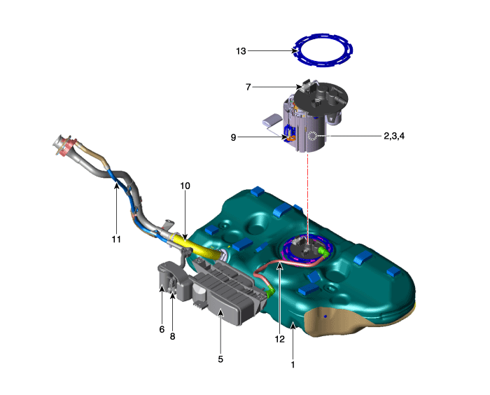

# Componentes e localização

[Home](../../index.md) / [Manual de Serviço e Reparo](../sportage-482.md) / [Motorização NU](index.md) / Componentes e localização

## Localização dos Componentes

| 1. Tanque de Combustível 2. Bomba de Combustível 3. Filtro de Combustível 4. Regulador de Pressão de Combustível 5. Canister 6. Filtro de Ar do Tanque de Combustível (FTPS) | 7. Sensor de Nível de Combustível (FLS) 8. Válvula de Fechamento do Canister (CCV) 9. Tubo de Enchimento do Combustível 10. Tubo de Ventilação 11. Tubo de Vapores 12. Cobertura da Placa da Bomba de Combustível |
| --- | --- |
