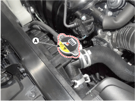
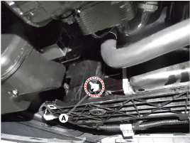
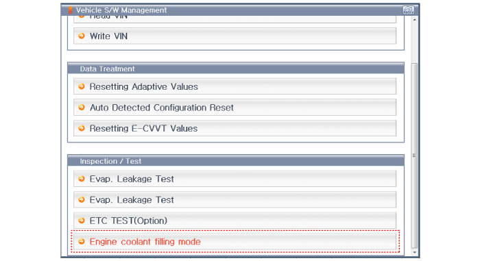
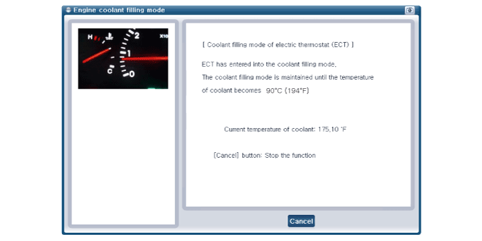
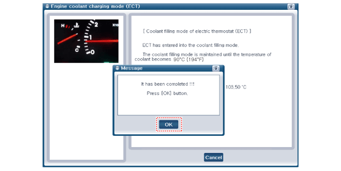
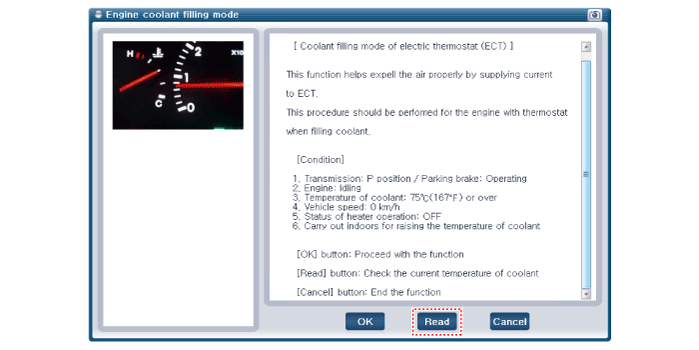
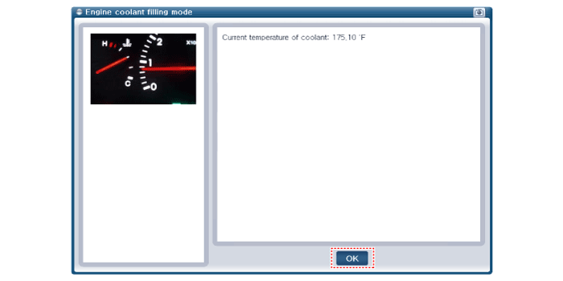

# Kia Sportage SL: Motorização NU / Coolant Repair procedures

[Início](../../index.md) / [Manual de Serviço do Kia Sportage NU](index.md) / [Sistema Mecânico do Motor](nu-engine_mechanical_system-2850.md) / [Sistema de Resfriamento](nu-cooling_system-2896.md) / Procedimentos de Troca de Refrigerante

## Preenchimento e Descarga

> **Cuidado**
>
> - Nunca remova a tampa do radiador quando o motor estiver quente. Pode ocorrer uma queimadura grave devido a líquido quente sob pressão alta escapando do radiador.

> **Nota**
>
> - Ao derramar líquido de refrigeração do motor, certifique-se de fechar a tampa do caixa relé e não permita que o líquido de refrigeração atinja partes elétricas ou pintura. Se o líquido de refrigeração escorrer, lave-o imediatamente.

1. Certifique-se de que o motor e o radiador estão frios ao toque.

2. Remova a tampa do radiador (A).

   

3. Remova a cobertura do compartimento do motor.

   (Consulte Montagem do Motor e Transmissão - "Cobertura do Compartimento do Motor")

4. Desloque o parafuso de drenagem (A) e drenagem do líquido de refrigeração.

   

5. Aperte o parafuso de drenagem do radiador de forma segura.

6. Após drenar o líquido de refrigeração no tanque de reservatório, limpe o tanque.

7. Preencha a mistura com líquido de refrigeração e água (55~60%) (exceto para América do Norte, Europa e China: 45~50%) lentamente através da tampa do radiador.

   > **Nota**
   >
   > - Use apenas antirrefrigeração genuíno.
   > - Para a melhor proteção contra corrosão, a concentração do líquido de refrigeração deve ser mantida ao longo do ano em 55% (exceto para América do Norte, Europa e China: 45%) mínimo.
   > - Concentrações de líquido de refrigeração abaixo de 55% (exceto para América do Norte, Europa e China: 45%) podem não fornecer proteção suficiente contra corrosão ou congelamento.
   > - Concentrações de líquido de refrigeração acima de 60% comprometerão a eficiência de resfriamento e não são recomendadas.
   > - Sempre use novo líquido de refrigeração.

   > **Cuidado**
   >
   > - Não misture marcas diferentes de antirrefrigeração.
   > - Não use aditivos adicionais de proteção contra ferrugem ou anticorrosão; eles podem não ser compatíveis com o líquido de refrigeração.

8. Realize o modo de preenchimento do líquido de refrigeração no GDS para expelir o ar do sistema de resfriamento.

   > **Nota**
   >
   > - Como um termostato elétrico (temperatura de abertura 100°C) é aplicado no motor, preencha o líquido e use o GDS para entrar no modo de preenchimento do líquido de refrigeração e expelir o ar.

   [Modo de Preenchimento do Líquido de Refrigeração]

   | • Texto de Guia no GDS: Em um motor equipado com um termostato elétrico (ECT), a corrente é aplicada ao termostato elétrico enquanto se preenche o líquido para ajudar a expelir o ar suficientemente. | |
   | --- | --- |
   | • | Texto de Guia no GDS: Em um motor equipado com um termostato elétrico (ECT), a corrente é aplicada ao termostato elétrico enquanto se preenche o líquido para ajudar a expelir o ar suficientemente. |

   1. Desligue o interruptor de ignição.

   2. Conecte o GDS ao Conector de Dados de Ligação (DLC).

   3. Ligue o interruptor de ignição.

   4. Selecione "Veículo, Ano do Modelo, Motor, Sistema".

   5. Selecione "Gerenciamento de Software do Veículo".

   ? Condições para Entrar no Modo de Preenchimento

   1. O câmbio estiver em posição P e o freio de estacionamento aplicado.

   2. O motor estiver em idle.

   3. A temperatura do líquido de refrigeração estiver 75°C ou superior.

4. A velocidade do veículo é 0 km/h.

5. O aquecedor está desligado.

6. Realize o trabalho dentro de um ambiente para ajudar a aumentar a temperatura do líquido de refrigeração.








[Verifique a temperatura do líquido de refrigeração]






? Condições para Desativar o Modo de Preenchimento

1. A temperatura do líquido de refrigeração é de 90°C (194°F) ou superior.

2. A opção de parada do modo de preenchimento foi selecionada no dispositivo de diagnóstico.

3. As condições para entrar no modo de preenchimento não são satisfeitas.

4. Ocorre uma condição de aborto do modo de preenchimento, como falha do aquecedor ECT ou falha do WTS.

> **Cuidado**
>
> - Não acelere o motor.

9. Instale a tampa do radiador e preencha a caixa de expansão até a linha "MAX" + 0,4 L (ou "FULL" + 0,4 L) com líquido de refrigeração.

10. Pare o motor e aguarde que o líquido de refrigeração esfrie.

11. Repita os passos 8 a 10 até que o nível do líquido não caia mais, descarregue o ar do sistema de refrigeração.

> **Nota**
>
> - Leva tempo para descarregar todo o ar do sistema de refrigeração.
    Refaça o preenchimento do líquido de refrigeração quando o líquido esfriar completamente, então verifique o
   nível do líquido na caixa de expansão nos 2~3 dias após a substituição
   do líquido de refrigeração.

```
Capacidade do líquido de refrigeração
Aproximadamente 6,6 L (1,66 U.S.gal., 6,97 U.S.qt., 5,81 lmp.qt.)
```
