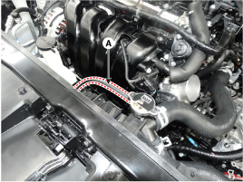
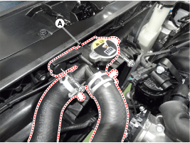
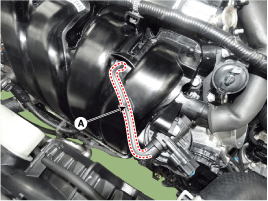
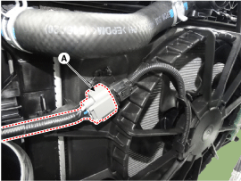
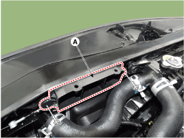
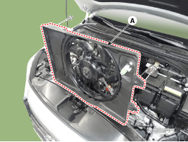
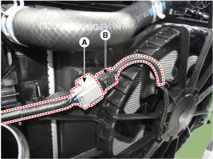
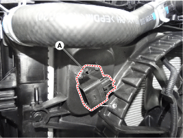
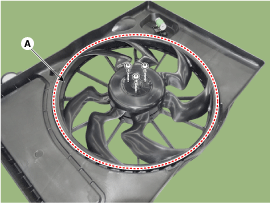
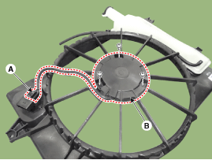

# Ventilador de arrefecimento — procedimentos

[Home](../../index.md) / [Manual de Serviço e Reparo](../sportage-482.md) / [Motorização NU](index.md) / Ventilador de arrefecimento — procedimentos

## Remoção e Instalação

Fan de resfriamento

1. Desconecte o terminal negativo da bateria.

2. Remova a mangueira de admissão e o conjunto do filtro de ar.

   (Consulte o Sistema de Admissão e Exaustão - "Filtro de Ar")

3. Desconecte a mangueira de derramamento (A).

   

4. Remova o conjunto do tanque de admissão (A).

   ```
   Torque de aperto:
   3,9 ~ 5,9 N.m (0,4 ~ 0,6 kgf.m, 2,9 ~ 4,3 lb-ft)
   ```

   

5. Desconecte a mangueira do solenoide do admissão variável (VIS) (A).

   

6. Desconecte o conectador do fio do conjunto elétrico (A).

   

7. Remova a proteção do admissão (A).

   ```
   Torque de aperto:
   7,8 ~ 9,8 N.m (0,8 ~ 1,0 kgf.m, 5,8 ~ 7,2 lb-ft)
   ```

   

8. Remova o conjunto do fan de resfriamento (A).

   ```
   Torque de aperto:
   4,9 ~ 7,8 N.m (0,5 ~ 0,8 kgf.m, 3,6 ~ 5,8 lb-ft)
   ```

   

9. Instale na ordem inversa da remoção.

Resistor

1. Desconecte o terminal negativo da bateria.

2. Desconecte o conectador do fio do conjunto elétrico (A) e o conectador do motor do fan (B).

   

3. Remova o resistor (A) do conjunto do fan de resfriamento.

   ```
   Torque de aperto:
   1,8 ~ 2,5 N.m (0,18 ~ 0,25 kgf.m, 1,3 ~ 1,8 lb-ft)
   ```

   

4. Instale na ordem inversa da remoção.

## Desmontagem

1. Remova o fan de resfriamento (A) do conjunto do fan de resfriamento.

   ```
   Torque de aperto:
   2,8 ~ 3,2 N.m (0,28 ~ 0,33 kgf.m, 2,0 ~ 2,4 lb-ft)
   ```

   

2. Desconecte o conectador do motor do fan (A) do resistor e, em seguida, remova o motor do fan (B).

   ```
   Torque de aperto:
   3,9 ~ 5,9 N.m (0,4 ~ 0,6 kgf.m, 2,9 ~ 4,3 lb-ft)
   ```

   

3. Montagem na ordem inversa da desmontagem.

## Inspeção

Motor do Fan

1. Desconecte o conectador do motor do fan do resistor.

2. Conecte a tensão da bateria ao terminal "+" e a massa ao terminal "-".

3. Verifique se o motor do fan opera corretamente.
