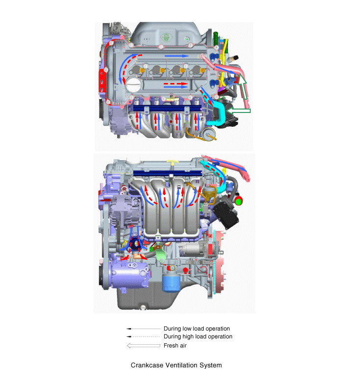
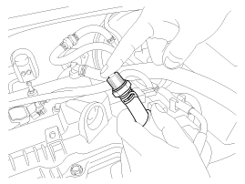
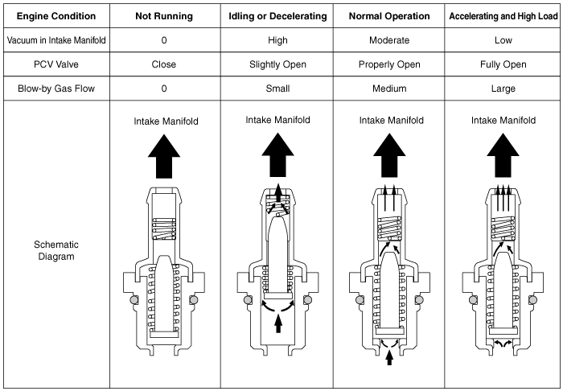
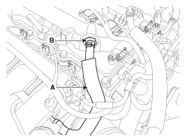
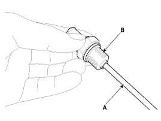

# Controle de emissões do cárter

[Home](../../index.md) / [Manual de Serviço e Reparo](../sportage-482.md) / [Motorização NU](index.md) / Controle de emissões do cárter

## Diagramas Schematicos

## Diagrama Schematico



## Procedimentos de Reparo

## Inspeção

1. Após desconectar a mangueira de vapor da válvula PCV, remova a válvula PCV.

2. Reconecte a válvula PCV à mangueira de vapor.

3. Inicie o motor e deixe-o em idle, então cubra o final aberto da válvula PCV com o polegar e verifique se pode sentir o vácuo do manifold de admissão.

   > **Nota**
   >
   > - O plunger dentro da válvula PCV se moverá de frente e para trás sob vácuo.

   

4. Se o vácuo não for sentido, inspecione a operação da válvula PCV. Se estiver operando corretamente, limpe ou substitua a mangueira de vapor.

## Descrição e Operação do Válvula de Ventilação do Casco Positiva (PCV)

## Princípio de Operação



## Procedimentos de Reparo do Válvula de Ventilação do Casco Positiva (PCV)

## Remoção

1. Desconecte a mangueira de vapor (A).

2. Remova a válvula PCV (B).

   

## Inspeção

1. Insira um palito fino (A) na válvula PCV (B) do lado threadado para verificar o movimento do plunger.

   

   > **Nota**
   >
   > - Se o plunger não se mover (a válvula PCV está entupido), limpe ou substitua a válvula.

## Instalação

1. A instalação é o inverso da remoção.

   ```
   Instalação do Válvula PCV :
   1.96 ~ 2.94 N.m (0.2 ~ 0.3 kgf.m, 1.45 ~ 2.17 lb-ft)
   ```
