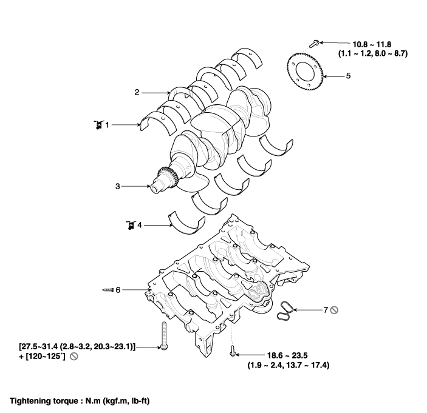

# Kia Sportage SL: Motorização NU / Crankshaft Components and Components Location

[Home](../../index.md) / [Kia Sportage SL Service & Repair Manual](../sportage-482.md) / [Motorização NU](index.md) / Crankshaft Components and Components Location

## Componentes

| 1. Suporte superior do cilindro 2. Suporte de deslizamento do cilindro 3. Cilindro 4. Suporte inferior do cilindro | 5. Discagem do sensor de posição do cilindro (CKPS) 6. Fundo inferior do bloco do motor 7. Gasket |
| --- | --- |
