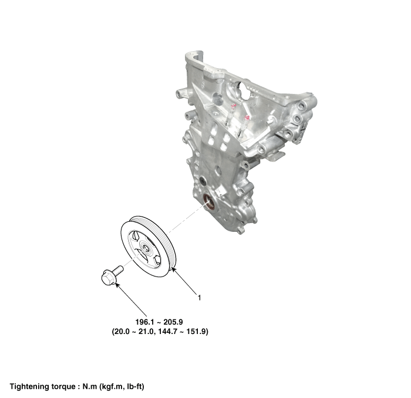

# Polia amortecedora do virabrequim — componentes e localização

[Home](../../index.md) / [Manual de Serviço e Reparo](../sportage-482.md) / [Motorização NU](index.md) / Polia amortecedora do virabrequim — componentes e localização

## Componentes

| 1. Furação do timão |  |
| --- | --- |
