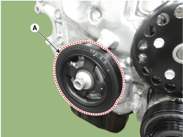

# Polia amortecedora do virabrequim — procedimentos

[Home](../../index.md) / [Manual de Serviço e Reparo](../sportage-482.md) / [Motorização NU](index.md) / Polia amortecedora do virabrequim — procedimentos

## Remoção e Instalação

1. Remova a roda dianteira direita.

   (Consulte o Sistema de Suspensão - "Rodas")

2. Remova a corrente.

   (Consulte o Sistema de Alinhamento - "Corrente")

3. Remova o cobertor inferior do compartimento do motor.

   (Consulte a Montagem do Motor e do Caso Transmissor - "Cobertor Inferior do Compartimento do Motor")

4. Remova a polia do balancim da tampa (A).

   ```
   Torque de aperto :
   196,1 ~ 205,9 N.m (20,0 ~ 21,0 kgf.m, 144,7 ~ 151,9 lb-ft)
   ```

   

   > **Nota**
   >
   > - Não aplique pressão na polia ou forças excessivas para evitar a deformação da parte elástica.

   | Existem dois métodos para segurar o engrenagem do balancim ao remover a polia do balancim da tampa. • Instale o SST (09231-2B100, 09231-3N100) para segurar o engrenagem após a remoção do starter. • Instale o SST (09231-3D100, 09231-2W100) para segurar o engrenagem após a remoção do cobertor de serviço. 1. Remova as parafusos de montagem do caso transmissor (A) e o cobertor de serviço (B) no fundo do caso inferior do balancim. 2. Remova o parafuso de montagem do caso transmissor (C) no fundo do caso inferior do balancim. 3. Ajuste a distância do segurador (A) para que as ranhuras do segurador sejam posicionadas na posição mais próxima das engrenagens do balancim (B). 4. Ajuste o ângulo e a distância dos ligamentos (C) para que os dois
   parafusos de montagem do caso transmissor possam ser fixados nos orifícios originais. 5. Instale o SST usando os dois parafusos de montagem do caso transmissor. Ajuste os parafusos e as ligações do segurador e dos ligamentos firmemente. | |
   | --- | --- |
   | • | Instale o SST (09231-2B100, 09231-3N100) para segurar o engrenagem após a remoção do starter. |
   | • | Instale o SST (09231-3D100, 09231-2W100) para segurar o engrenagem após a remoção do cobertor de serviço. |
   | 1. | Remova os parafusos de montagem do caso transmissor (A) e o cobertor de serviço (B) no fundo do caso inferior do balancim. |
   | 2. | Remova os parafusos de montagem do caso transmissor (C) no fundo do caso inferior do balancim. |
   | 3. | Ajuste a distância do segurador (A) para que as ranhuras do segurador sejam posicionadas na posição mais próxima das engrenagens do balancim (B). |
   | 4. | Ajuste o ângulo e a distância dos ligamentos (C) para que os dois
   parafusos de montagem do caso transmissor possam ser fixados nos orifícios originais. |
   | 5. | Instale o SST usando os dois parafusos de montagem do caso transmissor. Ajuste os parafusos e as ligações do segurador e dos ligamentos firmemente. |

5. Instale na ordem inversa da remoção.

## Inspeção

Verifique a polia do balancim da tampa para vibrações em rotação e depósito de óleo e poeira na parte V-ribbed. Substitua se necessário.
