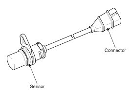

# Sensor CKPS (posição do virabrequim) — descrição e operação

[Home](../../index.md) / [Manual de Serviço e Reparo](../sportage-482.md) / [Motorização NU](index.md) / Sensor CKPS (posição do virabrequim) — descrição e operação

## Descrição

Sensor de Posição do Crankshaft (CKPS) detecta a posição do crankshaft e é um dos sensores mais importantes do sistema de controle do motor. Se não houver entrada de sinal CKPS, o motor pode parar devido à falta do sinal CKPS. Este sensor é instalado no bloco do cilindro ou na caixa transmissor e gera corrente alternada por meio do fluxo magnético criado pelo sensor e pela roda-alvo quando o motor está em funcionamento.

A roda-alvo consiste em 58 slots e 2 slots ausentes em 360 graus CA (Ângulo de Crankshaft).

