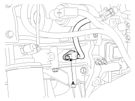

# Sensor CKPS (posição do virabrequim) — procedimentos

[Home](../../index.md) / [Manual de Serviço e Reparo](../sportage-482.md) / [Motorização NU](index.md) / Sensor CKPS (posição do virabrequim) — procedimentos

## Inspeção

1. Verifique a onda de sinal do CKPS e do CMPS usando um ferramenta de escaneamento.

   ```
   Especificação : Consulte "Onda de Sinal"
   ```

## Remoção

1. Desligue o interruptor de ignição e desconecte o cabo negativo (-) da bateria.

2. Desconecte o conectador do sensor de posição do virabrequim (A) e remova o sensor após remover o parafuso de instalação.

   

## Instalação

> **Cuidado**
>
> - Instale o componente com as torques especificadas.
> - Tenha em mente que danos internos podem ocorrer quando o componente é
deslocado. Se o componente foi deslocado, inspecione antes de instalar.

> **Cuidado**
>
> - Aplicar óleo de motor no anel O.
> - Insira o sensor na vaga de instalação e tenha cuidado para não danificar.

1. A instalação é o inverso da remoção.

   ```
   Parafuso de instalação do sensor de posição do virabrequim :
   9,8 ~ 11,8 N.m (1,0 ~ 1,2 kgf.m, 7,2 ~ 8,7 lb-ft)
   ```
