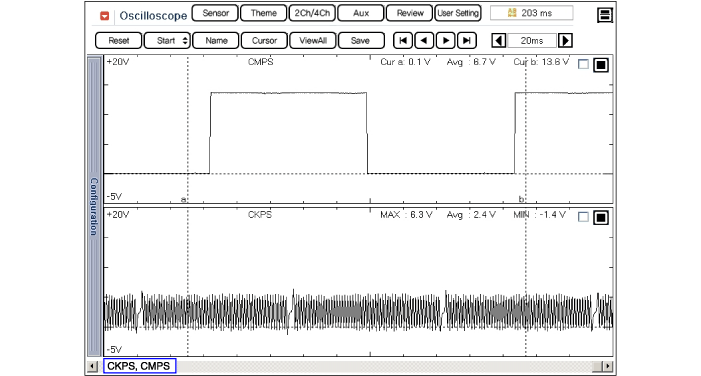
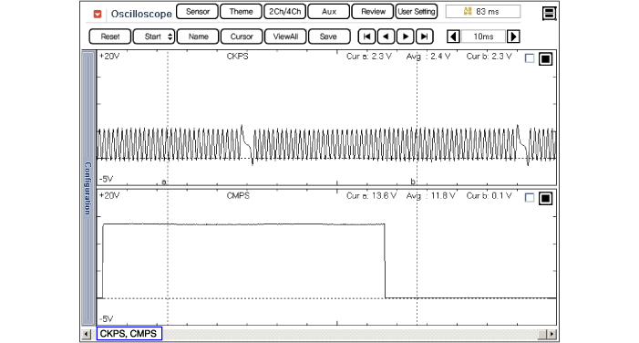

# Kia Sportage SL: Motorização NU / Crankshaft Position Sensor (CKPS) Troubleshooting

[Home](../../index.md) / [Kia Sportage SL Service & Repair Manual](../sportage-482.md) / [Motorização NU](index.md) / Crankshaft Position Sensor (CKPS) Troubleshooting

## Oscilação

