# Virabrequim — procedimentos

[Home](../../index.md) / [Manual de Serviço e Reparo](../sportage-482.md) / [Motorização NU](index.md) / Virabrequim — procedimentos

## Desmontagem

> **Nota**
>
> - Use coberturas de capô para evitar danos às superfícies pintadas.
> - Para evitar danos ao cabeçote do cilindro, aguarde que a temperatura do líquido de resfriamento do motor caia abaixo da temperatura normal (20°C [68°F]) antes de removê-lo.
> - Ao manipular uma borracha metálica, tenha cuidado para não dobrar a borracha ou danificar a superfície de contato da borracha.
> - Para evitar danos, desconecte cuidadosamente os conectores de fiação mantendo a parte do conectador.

| • Marque todos os fios e mangueiras para evitar conexões incorretas. • Vire a roda do comando para que o pistão nº1 esteja no TDC (Top dead center). |  |
| --- | --- |
| • | Marque todos os fios e mangueiras para evitar conexões incorretas. |
| • | Vire a roda do comando para que o pistão nº1 esteja no TDC (Top dead center). |

1. Remova a unidade do motor do veículo.

   (Consulte a Montagem do Motor e da Transmissão - "Montagem do Motor e da Transmissão")

2. Remova a unidade da transmissão da unidade do motor.

   Transmissão Automática

   (Consulte o Sistema de Transmissão Automática - "Transmissão Automática")

3. Remova a placa de transmissão.

   (Consulte a Bloco do Cilindro - "Placa de Transmissão")

4. Remova a selagem traseira.

   (Consulte a Bloco do Cilindro - "Selagem Traseira")

5. Instale o motor em um suporte para desmontagem.

6. Remova a corrente de comando.

   (Consulte o Sistema de Sincronização - "Corrente de Sincronização")

7. Remova a unidade do bomba d'água.

   (Consulte o Sistema de Resfriamento - "Bomba d'Água")

8. Remova a conexão de entrada de água e a unidade do termostato elétrico (ECT).

   (Consulte o Sistema de Resfriamento - "Termostato Elétrico (ECT)")

9. Remova o manífato de admissão.

   (Consulte o Sistema de Admissão e Emissão - "Manífato de Admissão")

10. Remova o compressor do ar condicionado.

    (Consulte o Sistema de Aquecimento, Ventilação e Ar Condicionado - "Compressor")

11. Remova o manífato de emissão.

    (Consulte o Sistema de Admissão e Emissão - "Manífato de Emissão")

12. Remova a unidade do cabeçote do cilindro.

    (Consulte a Unidade do Cabeçote do Cilindro - "Cabeçote do Cilindro")

13. Remova o filtro de óleo.

    (Consulte o Sistema de Lubrificação - "Óleo do Motor")

14. Remova a grade de óleo.

    (Consulte o Sistema de Lubrificação - "Bacia de Óleo")

15. Remova as juntas de pistão e de biela.

    (Consulte o Bloco do Cilindro - "Pistão e Biela")

16. Verifique a tolerância de lubrificação do rolo do comando.

17. Remova a caixa de baixo do comando (A).

    (1) Remova as varetas de fixação da caixa de baixo do comando.

     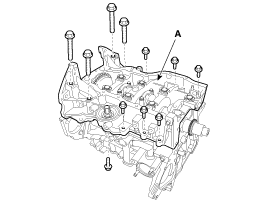

    (2) Remova as varetas de fixação do capuz principal.

     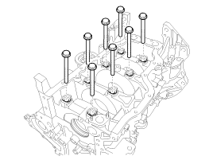

18. Verifique o deslocamento final do comando.

19. Levante o comando (A) do motor, cuidando para não danificar os rolos.

     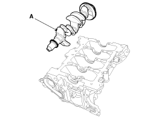

     **Nota**
     >
     > - Disponha as mancais principais e as casquilhos de rotação no ordem correta.

## Inspeção

1. Verifique a folga de óleo entre o virabrequim e as casquilhos.

   (1) Para verificar a folga de óleo entre as mancais principais e os eixos, remova a parte inferior da caixa do cárter e as mancais principais.

   (2) Limpe cada munhão principal e casquilho com uma toalha de oficina limpa.

   (3) Coloque uma faixa de plastigage em cada munhão principal.

   (4) Reinstale a parte inferior do cárter e as mancais principais, e depois aperte as engrenagens principais.

    ```
    Torque de aperto
    1ª etapa:
    27,5 ~ 31,4 N.m (2,8~3,2 kgf.m, 20,3 ~ 23,1 lb-ft)
    2ª etapa: 120 ~ 125°
    ```

    > **Nota**
    >
    > - Não gire o virabrequim.

   (5) Remova a parte inferior do cárter e as mancais principais.

   (6) Meda a largura da faixa de plastigage em seu ponto mais largo.

    ```
    Folga de óleo:
    0,016 ~ 0,034 mm (0,00063 ~ 0,00134 in.)
    ```

    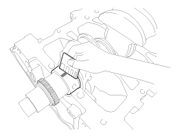

   (7) Se a faixa de plastigage medir muito larga ou muito estreita, remova as casquilhos superiores e inferiores e, em seguida, instale novas casquilhos com a mesma marca de cor. Repita a medição da folga de óleo.

    > **Nota**
    >
    > - Não filete, ajuste com um rechageamento ou esfregue as casquilhos ou as tampas para ajustar a folga.

   (8) Se a faixa de plastigage indicar que a folga ainda está incorreta, tente a casquilho de tamanho maior ou menor. Repita a medição da folga de óleo.

    > **Nota**
    >
    > - Se a folga correta não puder ser obtida usando as casquilhos de tamanho maior ou menor apropriadas, substitua o virabrequim e comece novamente.

    > **Nota**
    >
    > - Se as marcas estiverem ilegíveis devido à acumulação de sujeira e poeira, não limpe-as com uma escova ou raspador. Limpe-as apenas com solvente ou sabão.

    Marca do Bore do Bloco do Motor

    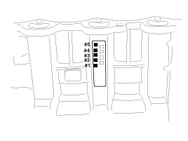

    Letras foram estampadas no bloco como marca para o diâmetro interno de cada um dos 5 munhões principais.

    Use-as, juntamente com os números ou barra estampada no crank (marcas para o diâmetro do munhão principal), para escolher as casquilhos corretas.

    Especificações do Bloco do Motor

    | Classe | Marca | Diâmetro Interno |
    | --- | --- | --- |
    | a | A | 59,000 ~ 59,006 mm (2,32283 ~ 2,32307 in.) |
    | b | B | 59,006 ~ 59,012 mm (2,32307 ~ 2,32330 in.) |
    | c | C | 59,012 ~ 59,018 mm (2,32330 ~ 2,32354 in.) |

    Marca do Virabrequim

    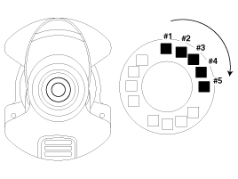

    > **Nota**
    >
    > - Conforme a ordem de estampagem indicada pela seta, a partir do #1.

    Especificações do Virabrequim

    | Classe | Marca | Diâmetro Externo do Eixo |
    | --- | --- | --- |
    | I | 1 | 54,954 ~ 54,960 mm (2,16354 ~ 2,16378 in.) |
    | II | 2 | 54,948 ~ 54,954 mm (2,16330 ~ 2,16354 in.) |
    | III | 3 | 54,942 ~ 54,948 mm (2,16307 ~ 2,16330 in.) |

    Marca do Casquilho do Virabrequim

    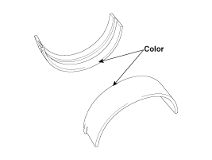

    Especificações do Casquilho do Virabrequim

    | Classe | Marca | Espessura da Casquilho |
    | --- | --- | --- |

| A | Azul | 2,021 ~ 2,024 mm (0,07957 ~ 0,07968 in.) |
    | B | Preto | 2,018 ~ 2,021 mm (0,07945 ~ 0,07957 in.) |
    | C | Nenhum | 2,015 ~ 2,018 mm (0,07933 ~ 0,07945 in.) |
    | D | Verde | 2,012 ~ 2,015 mm (0,07921 ~ 0,07933 in.) |
    | E | Amarelo | 2,009 ~ 2,012 mm (0,07909 ~ 0,07921 in.) |

   (9) Selecione um rolamento do virabrequim usando o gráfico de seleção.

    Gráfico de Seleção Para Rolamentos do Virabrequim

    | Classificação de Montagem do Rolamento | Marcação de Identificação do Bore do Virabrequim | --- | --- | --- |
    | a (A) | b (B) | c (C) | | |
    | Marcação de Identificação do Virabrequim | I (1) | E (Amarelo) | D (Verde) | C (Nenhum) |
    | II (2) | D (Verde) | C (Nenhum) | B (Preto) | |
    | III (3) | C (Nenhum) | B (Preto) | A (Azul) | |

2. Verifique a folga axial do virabrequim.

   Usando um indicador de dial, medir a folga de thrust enquanto empurra o virabrequim de um lado para o outro com uma furadeira.

   Se a folga axial for maior que o máximo, substitua o rolamento central.

   ```
   Play final
   Padrão: 0,07 ~ 0,25 mm (0,0028 ~ 0,0098 in.)
   ```

   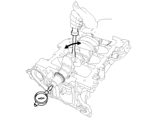

3. Inspeção dos journals principais e das engrenagens do virabrequim.

   Usando um micrômetro, medir o diâmetro de cada journal principal e engrenagem do virabrequim.

   ```
   Diâmetro do journal principal:
   54,942 ~ 54,960 mm (2,16307 ~ 2,16378 in.)
   Diâmetro da engrenagem do virabrequim:
   44,954 ~ 44,972 mm (1,76984 ~ 1,77055 in.)
   ```

   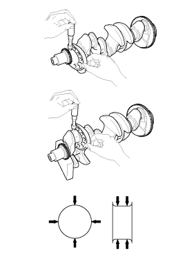

## Reajuste

> **Nota**
>
> - Limpe todos os componentes a serem montados.
> - Antes de instalar os componentes, aplique óleo de motor fresco em todas as superfícies deslizantes e rotativas.

1. Monte as rolamentos principais do virabrequim.

   > **Nota**
   >
   > - Os rolamentos superiores têm um sulco com orifícios de óleo; os rolamentos inferiores não têm.

   (1) Alinhe a garrucha do rolamento com o sulco do bloco do cilindro e empurre os 5 rolamentos superiores (A).

    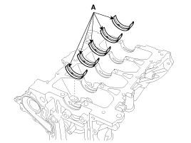

   (2) Alinhe a garrucha do rolamento com o sulco da parte inferior do virabrequim (B) e empurre os 5 rolamentos inferiores (A).

    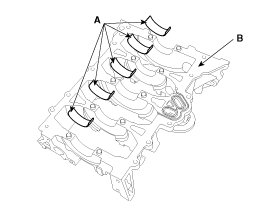

2. Monte os rolamentos de deslizamento.

   Monte os 2 rolamentos de deslizamento (A) nos dois lados do eixo 3 do bloco do cilindro com o sulco voltado para fora.

   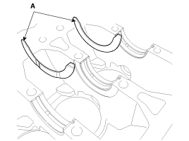

3. Coloque o virabrequim (A) no bloco do cilindro.

   

4. Aplique selante líquido na superfície superior da parte inferior do virabrequim.

   (1) Usando um raspador de gasket, remova todo o material antigo de vedação das superfícies do gasket.

   (2) As localizações do selante na parte inferior do virabrequim e no bloco do cilindro devem estar livres de materiais estranhos prejudiciais, óleo, poeira e umidade. Espere a superfície secar e limpe com limpa-vidros.

   (3) Monte um novo gasket de borracha (A) na parte superior da parte inferior do virabrequim.

    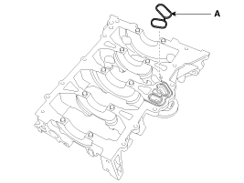

   (4) Aplique selante líquido na base do bloco do cilindro. Um fio contínuo de selante deve ser aplicado para prevenir qualquer caminho de vazamento de óleo.

    ```
    Largura do fio: 2,5 ~ 3,5 mm (0,10 ~ 0,14 in.)
    Selante: Threebond 1217H ou equivalente
    ```

    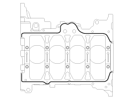

    > **Cautela**
    >
    > - Monte a parte inferior do virabrequim dentro de 5 minutos após a aplicação do selante.
    > - O teste de pressão ou o funcionamento do motor não deve ser realizado dentro de 30 minutos após a montagem da parte inferior do virabrequim.
    > - O excesso de selante na superfície de aplicação do selante em processos subsequentes deve ser removido antes de endurecer.
    > - Se o selante for aplicado na superfície superior da parte inferior do virabrequim, deve estar na mesma posição do bloco do cilindro.
    > - Para prevenir vazamento de óleo, aplique um selante de gasket nas fendas internas das fendas dos buracos das porcas.

5. Coloque a parte inferior do virabrequim no bloco do cilindro.

6. Monte as porcas de capa do rolamento principal.

   

   Usando SST (09221-4A000), monte e aperte as 10 porcas de capa do rolamento principal em várias etapas, na sequência mostrada.

   ```
   Torque de aperto
   1ª etapa:
   27,5 ~ 31,4 N.m (2,8 ~ 3,2 kgf.m, 20,3 ~ 23,1 lb-ft)
   2ª etapa: 120 ~ 125°
   ```

   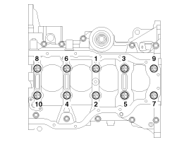

   > **Cautela**
   >

> - Não reutilize as varetas de fixação do capuz do rolamento.
> - Não aplique óleo de motor nas rosquetes para alcançar a torção correta.

> **Nota**
>
> - As rosquetes do capuz principal são apertadas em 2 etapas progressivas.
> - Se alguma das rosquetes do capuz principal estiver quebrada ou deformada, substitua-a.
> - Certifique-se de montar as rosquetes do capuz principal na ordem correta.

7. Monte as varetas inferiores do caixa do câmbio, em várias passadas, na sequência indicada.

   ```
   Torção de aperto:
   18,6 ~ 23,5 N.m (1,9 ~ 2,4 kgf.m, 13,7 ~ 17,4 lb-ft)
   ```

   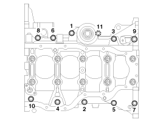

   Verifique que o virabrequim roda suavemente.

8. Verifique a folga axial do virabrequim.

9. Monte as outras partes na ordem inversa à desmontagem.

| • No caso de substituição do virabrequim por um novo, selecione o
  mancal da biela adequado de acordo com a marca do eixo do
  pistão no virabrequim. - Seleção do mancal da biela (Consulte Bloco do Cilindro - "Pistão e Braço do Pistão") |  |
| --- | --- |
| • | No caso de substituição do virabrequim por um novo, selecione o
  mancal da biela adequado de acordo com a marca do eixo do
  pistão no virabrequim. |
| - | Seleção do mancal da biela (Consulte Bloco do Cilindro - "Pistão e Braço do Pistão") |
