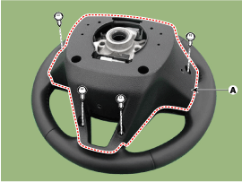
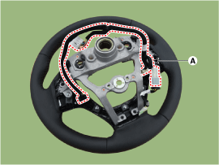
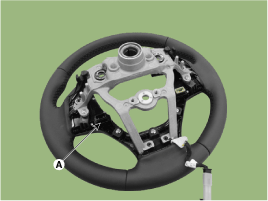
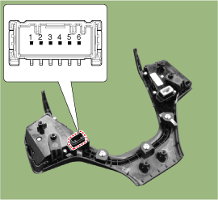

# Interruptor do controle de cruzeiro — procedimentos

[Home](../../index.md) / [Manual de Serviço e Reparo](../sportage-482.md) / [Motorização NU](index.md) / Interruptor do controle de cruzeiro — procedimentos

## Remoção

1. Desligue o interruptor de ignição e desconecte o cabo negativo (-) da bateria.

2. Remova a montagem do volante.

3. Remova as parafusos da cobertura traseira do volante (A).

   

4. Remova a conexão do controle remoto do volante (A) após soltar os parafusos.

   

5. Remova o controle remoto do volante (A) após soltar os parafusos.

   

## Instalação

1. Instale o controle remoto do volante e a cobertura após conectar a conexão.

2. Instale o volante e o módulo do airbag do motorista.

3. Conecte o terminal negativo (-) da bateria.

## Inspeção

1. Remova o interruptor de controle de velocidade.

2. Meda a resistência entre os terminais do interruptor de controle quando cada botão de função estiver ON (e o interruptor estiver pressionado).

   

   | Interruptor | Terminal da Conector | Resistência(±5%) |
   | --- | --- | --- |
   | CANCEL | 2 ~ 5 | 330 ? |
   | SET - | 2 ~ 5 | 550 ? |
   | RES + | 2 ~ 5 | 880 ? |
   | CRUISE | 2 ~ 5 | 1.44 k? |
