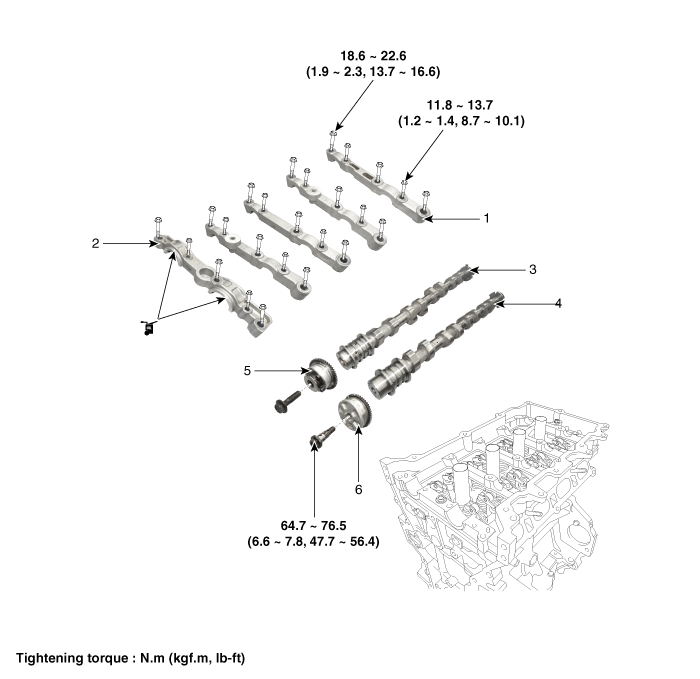

# Kia Sportage SL: Motorização NU / CVVT & Camshaft Components and Components Location

[Home](../../index.md) / [Kia Sportage SL Service & Repair Manual](../sportage-482.md) / [Motorização NU](index.md) / CVVT & Camshaft Components and Components Location

## Componentes

| 1. Cofre do eixo de câmaras 2. Cofre do amortecedor frontal do eixo de câmaras 3. Eixo de câmaras de escape | 4. Eixo de câmaras de admissão 5. Montagem do CVVT de escape 6. Montagem do CVVT de admissão |
