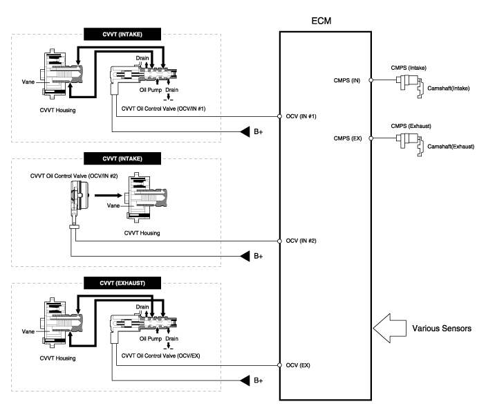
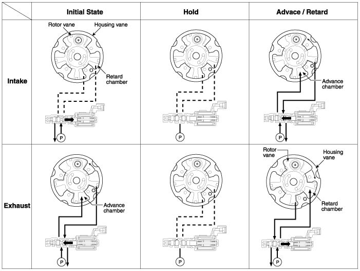
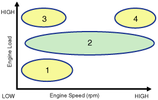

# CVVT e comando de válvulas — descrição e operação

[Home](../../index.md) / [Manual de Serviço e Reparo](../sportage-482.md) / [Motorização NU](index.md) / CVVT e comando de válvulas — descrição e operação

## Descrição

O sistema de Variação Contínua do Tempo de Abertura das Valves (CVVT) avança ou atrasa o tempo de abertura das válvulas de admissão e exaustão de acordo com o sinal de controle do ECM, que é calculado com base na velocidade do motor e no carregamento.

Controlando o CVVT, ocorre o sobreposição ou subordem das válvulas, o que melhora a economia de combustível e reduz as emissões de gases de escape (NOx, HC) e melhora o desempenho do motor através da redução da perda de bombeamento, do efeito de EGR interno, da estabilidade da combustão, da eficiência volumétrica e do trabalho de expansão.

Este sistema consiste em

| - | o Valvulário de Controle de Óleo do CVVT (OCV) que fornece óleo do motor ao faseador do timoneiro ou despeja o óleo do motor do faseador do timoneiro de acordo com o sinal de controle PWM (Pulse With Modulation) do ECM, |
| --- | --- |

| - | e o Faseador do Timoneiro que varia o faseamento do timoneiro usando a força hidráulica do óleo do motor. |
| --- | --- |

O óleo do motor que sai do valvulário de controle de óleo do CVVT varia o faseamento do timoneiro na direção (Avanço de Admissão/Retardo de Exaustão) ou no sentido oposto (Retardo de Admissão/Avanço de Exaustão) da rotação do motor, rotacionando o rotor conectado ao timoneiro dentro do faseador do timoneiro.

## Princípio de Operação

O CVVT tem o mecanismo de girar o vane do rotor com a força hidráulica gerada pelo óleo do motor suprido ao câmara de avanço ou atraso de acordo com o controle do valvulário de controle de óleo do CVVT.

| • Um solenoide separado está instalado na cobertura da corrente no lado de admissão para fechar e liberar um pincolet separado. |  |
| --- | --- |
| • | Um solenoide separado está instalado na cobertura da corrente no lado de admissão para fechar e liberar um pincolet separado. |

## [Sistema CVVT em Modo]

| (1) Baixa Velocidade / Baixa Carga | (2) Carga Parcial |
| --- | --- |
| (3) Baixa Velocidade / Alta Carga | (4) Alta Velocidade / Alta Carga |

| Condição de Direção | Valvula de Exaustão | Valvula de Admissão |  |  |
| --- | --- | --- | --- | --- |
| Ajuste do Tempo de Abertura | Efeito | Ajuste do Tempo de Abertura | Efeito |  |
| (1) Baixa Velocidade / Baixa Carga | Avanço Completo | * Ajuste da Sobrecruzamento * Melhoria da Estabilidade da Combustão | Atraso Completo | * Ajuste da Sobrecruzamento * Melhoria da Estabilidade da Combustão |
| (2) Carga Parcial | Atraso | * Redução de HC | Atraso | * Atrasa o Fechamento da Valvula de Admissão para Reduzir a Perda de Pompagem * Aumenta o Trabalho Expansivo |
| (3) Baixa Velocidade / Alta Carga | Atraso | * Aumento do Trabalho Expansivo | Avanço | * Prevenção do Retrocesso da Admissão (Melhoria da Eficiência Volumétrica) |
| (4) Alta Velocidade / Alta Carga | Avanço | * Redução da Perda de Pompagem | Atraso | * Melhoria da Eficiência Volumétrica |
