# CVVT e comando de válvulas — procedimentos

[Home](../../index.md) / [Manual de Serviço do Kia Sportage NU](index.md) / [Sistema Mecânico do Motor](nu-engine_mechanical_system-2850.md) / [Montagem do Bloco de Cilindros](nu-cylinder_head_assembly-2876.md) / CVVT e comando de válvulas — procedimentos

## Remoção

> **Nota**
>
> - Use cobertores de porta-luz para evitar danos às superfícies pintadas.
> - Para evitar danos, desconecte cuidadosamente os conectores de alimentação, segurando a parte do conector.

| • Marque todos os cabos e mangueiras para evitar a conexão incorreta. • Vire o pulley do eixo do crankshaft até que o pistão No. 1 esteja no topo do centro. |  |
| --- | --- |
| • | Marque todos os cabos e mangueiras para evitar a conexão incorreta. |
| • | Vire o pulley do eixo do crankshaft até que o pistão No. 1 esteja no topo do centro. |

A remoção da cobertura da corrente de sincronização não é necessária para este procedimento.

1. Remova a cobertura do cabeçote do cilindro.

   (Consulte a Montagem do Cabeçote do Cilindro - "Cobertura do Cabeçote do Cilindro")

2. Remova o atuador do CVVT intermédio (A).

   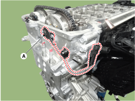

3. Defina o cilindro No. 1 no topo do centro (top dead center) durante a compressão.

   (1) Vire o pulley do eixo do crankshaft e alinhe a sua vagem com a marca de sincronização da cobertura da corrente de sincronização.

    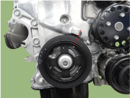

   (2) Verifique se as marcas de topo do centro (TDC) dos sprockets do CVVT de admissão e exaustão estão alinhadas na superfície do cabeçote do cilindro, como mostrado na ilustração. Se não estiverem, vire o eixo do crankshaft mais uma revolução (360°).

    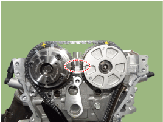

   (3) Marque as correntes de sincronização correspondentes às marcas de sincronização dos sprockets do CVVT.

    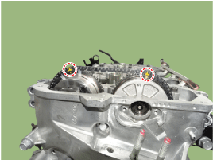

4. Remova o amortecedor do pulley do eixo do crankshaft.

   (Consulte o Sistema de Sincronização - "Amortecedor do Pulley do Eixo do Crankshaft")

5. Remova a viga de serviço (A) com o selo (B).

   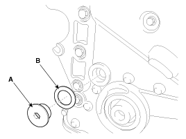

6. Remova a viga do tensionador (A).

   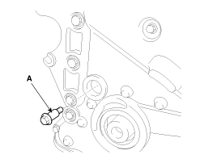

7. Empurre para baixo a viga do tensionador (A).

   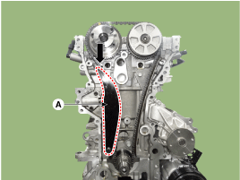

8. Remova as tampas do eixo do camshaft.

   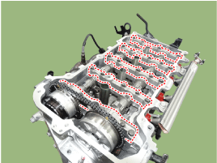

9. Remova o camshaft de exaustão (A) primeiro, depois o camshaft de admissão (B).

   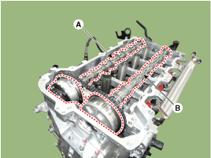

10. Remova a viga do tensionador (A).

    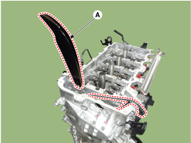

    | • Para segurar a corrente de sincronização, amarre-a com uma cinta. | |
    | --- | --- |
    | • | Para segurar a corrente de sincronização, amarre-a com uma cinta. |

11. Remova a montagem do CVVT (A) do eixo do camshaft.

    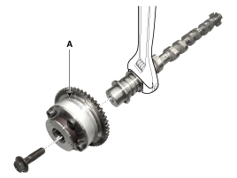

    | • Ao remover o parafuso do selo do CVVT, segure o eixo do camshaft com uma chave para prevenir o roteamento do eixo do camshaft. | |
    | --- | --- |
    | • | Ao remover o parafuso do selo do CVVT, segure o eixo do camshaft com uma chave para prevenir o roteamento do eixo do camshaft. |

## Inspeção

Caminhete

1. Inspeção das lâminas do cam.

   Utilize um micrômetro para medir a altura das lâminas do cam.

   Se a altura das lâminas do cam for menor que a especificação, substitua o cam.

   ```
   Altura do cam
   Admissão: 39,0 mm (1,5354 in.)
   Exaustão: 39,0 mm (1,5354 in.)
   ```

   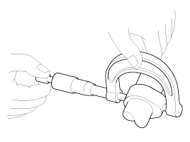

2. Verifique a superfície do eixo do cam para desgaste.

   Se o eixo estiver desgastado excessivamente, substitua o cam.

3. Inspeção da vaga do cam.

   (1) Limpe as cobertas de suporte e os eixos do cam.

   (2) Posicione os cam na cabeça do cilindro.

   (3) Coloque uma faixa de plastigage em cada um dos eixos do cam.

    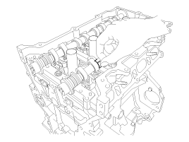

   (4) Instale as cobertas de suporte e aperte os parafusos com a torção especificada.

    ```
    Torção de aperto
    Parafusos M6:
    11,8 ~ 13,7 N.m (1,2 ~ 1,4 kgf.m, 8,7 ~ 10,1 lb-ft)
    Parafusos M8:
    18,6 ~ 22,6 N.m (1,9 ~ 2,3 kgf.m, 13,7 ~ 16,6 lb-ft)
    ```

    > **Nota**
    >
    > - Não gire o cam.

   (5) Remova as cobertas de suporte.

   (6) Medida do plastigage no ponto mais largo.

    Se a vaga do óleo for maior que a especificação, substitua
    o cam. Se necessário, substitua as cobertas de suporte e a cabeça do cilindro como um conjunto.

    ```
    Vaga do óleo
    Padrão:
    0,032 ~ 0,062 mm (0,00126 ~ 0,00244 in.)
    ```

    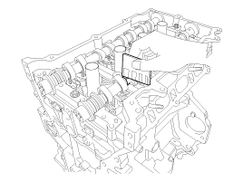

4. Inspeção do deslocamento final do cam.

   (1) Instale as cobertas de suporte do cam.

   (2) Utilize um indicador de dial para medir o deslocamento final enquanto move o cam de um lado para o outro.

    Se o deslocamento final for maior que a especificação, substitua o cam.

    Se necessário, substitua as cobertas de suporte e a cabeça do cilindro como um conjunto

    ```
    Deslocamento final do cam
    Padrão:
    0,10 ~ 0,19 mm (0,0039 ~ 0,0075 in.)
    ```

    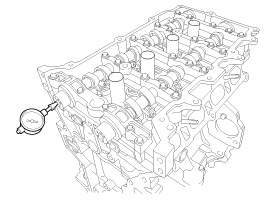

   (3) Remova os cam.

Montagem do tempo de abertura variável contínuamente (CVVT)

1. Inspeção do CVVT para rotação suave.

   (1) Fixe o cam com um vise. Cuide para não danificar as lâminas do cam e os eixos no vise.

   (2) Verifique se o CVVT está bloqueado girando-o no sentido horário ou anti-horário. Não deve girar.

   (3) CVVT de admissão: Cole uma fita em uma das duas fendas de avanço no eixo do cam.

    CVVT de exaustão: Cole uma fita em uma das duas fendas de atraso no eixo do cam.

    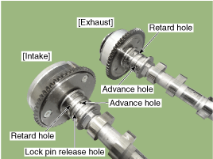

   (4) CVVT de admissão:

    (1) Pressione o centro do parafuso do valvulário (A).

    (2) Aplicar aproximadamente 50 kPa (0,5 kgf/cm?, 7 psi) de ar comprimido no orifício de liberação do bloqueio para liberar o bloqueio.

    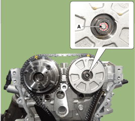

    CVVT de exaustão: Aplicar aproximadamente 150 kPa (1,5 kgf/cm? 21 psi) de ar comprimido no orifício de atraso não selado para liberar o bloqueio.

| • Cubra os caminhos de óleo com uma peça de pano quando aplicar ar comprimido para prevenir a dispersão de óleo. | |
    | --- | --- |
    | • | Cubra os caminhos de óleo com uma peça de pano quando aplicar ar comprimido para prevenir a dispersão de óleo. |

   (5) CVVT de Admissão: Com ar comprimido aplicado, rotacione o CVVT no sentido avanço (contraclockwise) dentro do seu intervalo de faseamento e verifique que o CVVT gira suavemente.

   CVVT de Exaustão: Com ar comprimido aplicado, rotacione o CVVT no sentido retraso (clockwise) e verifique que o CVVT gira suavemente.

    ```
    Intervalo de faseamento do CVVT
    Admissão : 40° (20° de avanço e 20° de retraso a partir da posição inicial)
    Exaustão : 20°±1° (do mais avançado ao mais retrasado)
    ```

    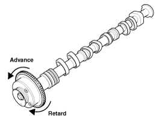

   (6) CVVT de Admissão:

    A. Mova para o centro para verificar que o pincoleta se feche bem.

    B. Rotacione o CVVT no sentido retraso (clockwise) até a posição mais retrasada e, em seguida, verifique que o CVVT está bloqueado.

    CVVT de Exaustão:

    A. Rotacione o CVVT no sentido avanço (contraclockwise) até a posição mais avançada e, em seguida, verifique que o CVVT está bloqueado.

    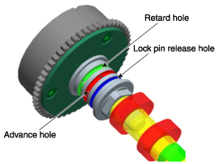

## Instalação

1. Instale a montagem CVVT (A) no cárter.

   ```
   Torque de aperto:
   64.7 ~ 76.5 N.m (6.6 ~ 7.8 kgf.m, 47.7 ~ 56.4 lb-ft)
   ```

   

   | • Quando instalando a viga de aperto da montagem CVVT, segure o cárter com uma chave para prevenir a rotação do cárter. | |
   | --- | --- |
   | • | Quando instalando a viga de aperto da montagem CVVT, segure o cárter com uma chave para prevenir a rotação do cárter. |

2. Comprenda o pistão do amortecedor usando um barra de ferramenta (A) e, em seguida, insira um pinho de parada (B) na abertura do amortecedor para segurar o pistão comprimido.

   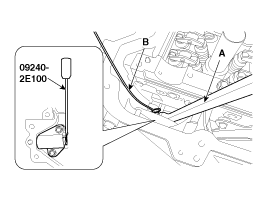

3. Posicione o cárter de admissão (A) e, em seguida, insira o braço do amortecedor (B) ao longo da corrente de admissão.

   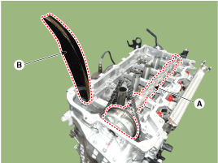

4. Posicione o cárter de escape (A).

   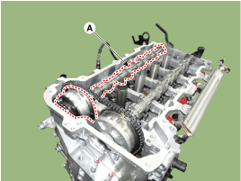

   > **Nota**
   >
   > - As marcas de sincronização de cada sprocket CVVT devem ser alinhadas com as marcas de sincronização (link pintado) da corrente de sincronização quando se instalar a corrente de sincronização.

5. Instale as tampas do suporte do cárter.

   

   Ajuste as varetas, em várias passadas, na sequência mostrada.

   ```
   Torque de aperto
   Varetas M6:
   11.8 ~ 13.7 N.m (1.2 ~ 1.4 kgf.m, 8.7 ~ 10.1 lb-ft)
   Varetas M8:
   18.6 ~ 22.6 N.m (1.9 ~ 2.3 kgf.m, 13.7 ~ 16.6 lb-ft)
   ```

   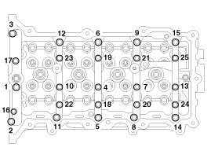

   > **Nota**
   >
   > - Cuide para não alterar a posição e a direção das tampas do suporte.

6. Usando uma ferramenta apropriada, mova o braço do amortecedor para alinhar a abertura da viga de aperto com a abertura de serviço.

   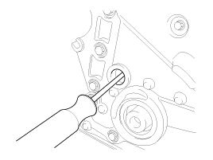

7. Instale a viga de aperto (A).

   ```
   Torque de aperto:
   18.6 ~ 22.6 N.m (1.9 ~ 2.3 kgf.m, 13.7 ~ 16.6 lb-ft)
   ```

   

8. Remova o pinho de parada do amortecedor.

9. Vire o cárter do motor duas voltas na direção de operação (horário) e, em seguida, verifique que as marcas TDC dos sprockets CVVT estejam alinhadas na superfície do cabeçote do cilindro.

   

10. Instale uma viga de serviço (A) com um selo.

    ```
    Torque de aperto:
    29.4 ~ 39.2 N.m (3.0 ~ 4.0 kgf.m, 21.7 ~ 28.9 lb-ft)
    ```

    

    > **Nota**
    >
    > - Não reutilize a viga de serviço e o selo.

11. Instale o amortecedor intermediário de bloqueio CVVT (A).

    ```
    Torque de aperto:
    8.8 ~ 9.8 N.m (0.9 ~ 1.0 kgf.m, 6.5 ~ 7.2 lb-ft)
    ```

    

    > **Nota**

> - Sempre use parafusos novos para o atuador.
> - O resíduo dentro da abertura do parafuso da cobertura da corrente deve ser descartado antes de fechar.
> - Os parafusos do atuador devem ser apertados com a torque regulamentar.

12. Instale as outras partes na ordem inversa ao remoção.
