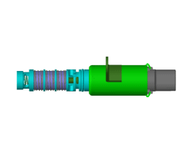
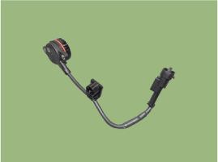
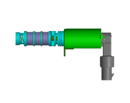

# Kia Sportage SL: Motorização NU / CVVT Oil Control Valve (OCV) Description and Operation

[Início](../../index.md) / [Manual de Serviço da Kia Sportage NU](index.md) / [Controle do Motor/Sistema de Combustível](nu-engine_control_fuel_system-3018.md) / [Sistema de Controle do Motor](nu-engine_control_system-3023.md) / Descrição e Operação da Valvula de Controle do Óleo CVVT (OCV)

## Descrição

O sistema de Variação Contínua da Tempo das Valvulas (CVVT) avança ou
retrai o tempo das valvulas de admissão e escape de acordo com o sinal de controle do ECM, que é calculado com base na velocidade do motor e no carregamento.

Controlando o CVVT, ocorre o sobrelapamento ou sublapamento das valvulas, o que melhora a economia de combustível e reduz as emissões de gases de escape (NOx, HC) e melhora o desempenho do motor através da redução da perda de bombeamento, do efeito de EGR interno, da melhoria da estabilidade da combustão, da eficiência volumétrica e do trabalho de expansão.

Este sistema consiste em

- a Valvula de Controle do Óleo CVVT (OCV) que regula o óleo do motor para e do cam phaser de acordo com o sinal de PWM (Pulse With Modulation) do ECM,

- e o Cam Phaser que varia o faseamento do cam por meio da força hidráulica do óleo do motor.

O óleo do motor que sai da valvula de controle do óleo CVVT varia o faseamento do cam girando o rotor conectado ao eixo do cam no cam phaser em direção (Avanço de Admissão/Retardo de Escape) ou direção oposta (Retardo de Admissão/Avanço de Escape) da rotação do motor.

[Bank 1 / Admissão] #1

[Bank 1 / Admissão] #2

[Bank 1 / Escape]

