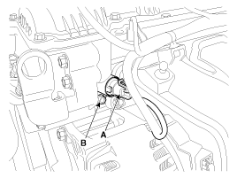
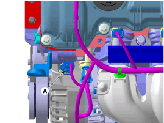
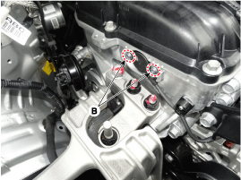
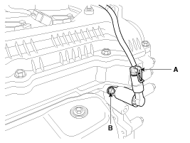

# Válvula OCV (CVVT) — procedimentos

[Home](../../index.md) / [Manual de Serviço e Reparo](../sportage-482.md) / [Motorização NU](index.md) / Válvula OCV (CVVT) — procedimentos

## Inspeção

1. Desligue o interruptor de ignição.

2. Desconecte o conector da OCV.

3. Mede a resistência entre os terminais 1 e 2 da OCV.

4. Verifique se a resistência está dentro da especificação.

   ```
   Especificação : Consulte a "Especificação"
   ```

## Remoção

1. Desligue o interruptor de ignição e desconecte o cabo negativo (-) da bateria.

2. Desconecte o conector da valvula de controle de óleo CVVT (A).

3. Remova a viga de instalação (B), e então remova a valvula do motor.

   [Banco 1 / Admissão] #1

   

   [Banco 1 / Admissão] #2

   

   

   [Banco 1 / Exaustão]

   

## Instalação

> **Cuidado**
>
> - Instale o componente com as torques especificadas.
> - Tenha em mente que danos internos podem ocorrer se o componente for solto. Neste caso, use após a inspeção.

> **Cuidado**
>
> - Aplicar óleo de motor na borracha do valvula.

1. A instalação é o inverso da remoção.

   ```
   Bola de instalação da valvula de controle de óleo CVVT :
   9,8 ~ 11,8 N.m (1,0 ~ 1,2 kgf.m, 7,2 ~ 8,7 lb-ft)
   ```
