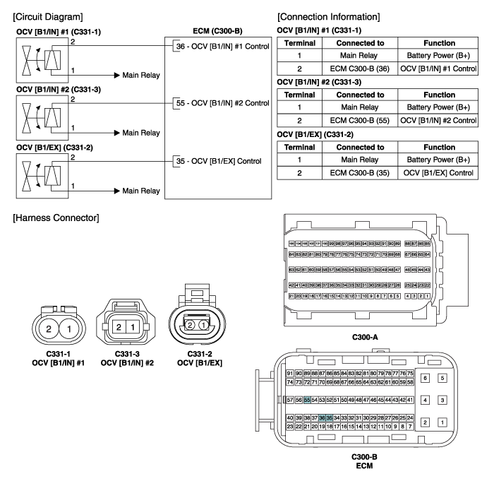

# Válvula OCV (CVVT) — diagramas esquemáticos

[Home](../../index.md) / [Manual de Serviço e Reparo](../sportage-482.md) / [Motorização NU](index.md) / Válvula OCV (CVVT) — diagramas esquemáticos

## Esquema Elétrico

