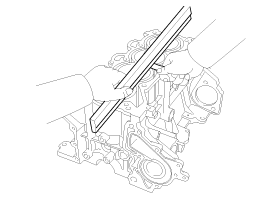
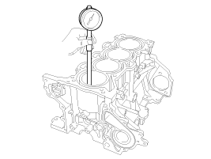

# Bloco do motor — procedimentos

[Home](../../index.md) / [Manual de Serviço e Reparo](../sportage-482.md) / [Motorização NU](index.md) / Bloco do motor — procedimentos

## Desmontagem

> **Nota**
>
> - Use cobertores de porta-rodas para evitar danos nas superfícies pintadas.
> - Aguarde que a temperatura do líquido de refrigeração do motor caia abaixo da temperatura normal (20°C [68°F]) antes de remover a cabeça do cilindro.
> - Ao lidar com uma borracha metálica, tome cuidado para não dobrar a borracha ou danificar a superfície de contato da borracha.
> - Para evitar danos, desconecte cuidadosamente os conectores de fiação enquanto segurar a parte do conectador.

| • Marque todos os fios e mangueiras para evitar conexões incorretas. • Vire o pulley do amortecedor do crankshaft para que o pistão nº1 esteja em TDC (Top dead center). |  |
| --- | --- |
| • | Marque todos os fios e mangueiras para evitar conexões incorretas. |
| • | Vire o pulley do amortecedor do crankshaft para que o pistão nº1 esteja em TDC (Top dead center). |

1. Remova a unidade do motor do veículo.

   (Consulte Montagem do Motor e Transaxle - "Montagem do Motor e Transaxle")

2. Remova a unidade do transaxle da unidade do motor.

   Transaxle Automático

   (Consulte Sistema de Transaxle Automático - "Transaxle Automático")

3. Remova a placa de transmissão.

   (Consulte Bloco do Cilindro - "Placa de Transmissão")

4. Remova a selagem traseira.

   (Consulte Bloco do Cilindro - "Selagem Traseira")

5. Instale o motor em um suporte para desmontagem.

6. Remova a corrente de sincronização.

   (Consulte Sistema de Sincronização - "Corrente de Sincronização")

7. Remova a unidade do pump de água.

   (Consulte Sistema de Refrigeração - "Pump de Água")

8. Remova a conexão de entrada de água e a unidade do termostato.

   (Consulte Sistema de Refrigeração - "Termostato Elétrico (ECT)")

9. Remova o manifolto de admissão.

   (Consulte Sistema de Admissão e Emissão - "Manifolto de Admissão")

10. Remova o compressor do A/C.

    (Consulte Sistema de Aquecimento, Ventilação e A/C - "Compressor")

11. Remova o manifolto de emissão.

    (Consulte Sistema de Admissão e Emissão - "Manifolto de Emissão")

12. Remova a unidade da cabeça do cilindro.

    (Consulte Montagem da Cabeça do Cilindro - "Cabeça do Cilindro")

13. Remova o filtro de óleo.

    (Consulte Sistema de Lubrificação - "Óleo do Motor")

14. Remova a grade de óleo.

    (Consulte Sistema de Lubrificação - "Bacia de Óleo")

15. Remova as montagens do pistão e do eixo de ligação.

    (Consulte Bloco do Cilindro - "Pistão e Eixo de Ligação")

16. Remova o eixo do crankshaft.

    (Consulte Bloco do Cilindro - "Eixo do Crankshaft")

17. Remova o sensor de batida.

    (Consulte Sistema de Controle do Motor/Sistema de Combustível - "Sensor de Batida (KS)")

18. Remova o sensor de posição do eixo do crankshaft (CKPS).

    (Consulte Sistema de Controle do Motor/Sistema de Combustível - "Sensor de Posição do Eixo do Crankshaft (CKPS)")

19. Remova o interruptor de pressão de óleo.

    (Consulte Sistema de Lubrificação - "Interruptor de Pressão de Óleo")

## Inspeção

1. Remova o material do selante.

   Usando um raspador de selante, remova todo o material do selante da superfície superior do bloco do cilindro.

2. Limpe o bloco do cilindro

   Usando um pincel macio e solvente, limpe completamente o bloco do cilindro.

3. Inspeção da superfície superior do bloco do cilindro para verificar a planíridade.

   Usando um guia de precisão e uma régua de fio, meda a superfície que entra em contato com o selante do cabeçote do cilindro para verificar a distorção.

   ```
   Planíridade da superfície do selante do bloco do cilindro
   Padrão:
   Menos de 0,05 mm (0,0020 in.) para a área total
   Menos de 0,02 mm (0,0008 in.) para uma seção de 100 mm (3,9370 in.) X 100 mm (3,9370 in.)
   ```

   

4. Inspeção do bore do cilindro

   Verifique visualmente o cilindro para riscos verticais.

   Se riscos profundos estiverem presentes, substitua o bloco do cilindro.

5. Inspeção do diâmetro do bore do cilindro.

   Usando um medidor de bore do cilindro, meda o diâmetro do bore do cilindro nas posições no sentido do thrust e axial.

   ```
   Diâmetro do bore do cilindro:
   81,00 ~ 81,03 mm (3,1890 ~ 3,1902 in.)
   ```

   

   | • Pontos de medição (da parte superior do bloco do cilindro): 10 mm (0,3937 in.) / 71 mm (2,7953 in.) / 131,5 mm (5,1772 in.) | |
   | --- | --- |
   | • | Pontos de medição (da parte superior do bloco do cilindro): 10 mm (0,3937 in.) / 71 mm (2,7953 in.) / 131,5 mm (5,1772 in.) |

## Reunião

1. Reúna as outras partes na ordem inversa da desmontagem.

| • No caso de substituição do bloco do cilindro por um novo, selecione
  o suporte principal do culiodeágua e o pistão de acordo com a marca do orifício do culiodeágua e a marca do bore do cilindro no bloco do cilindro. - Seleção do suporte principal do culiodeágua (Consulte o bloco do cilindro - "Culiodeágua") - Seleção do pistão (Consulte o bloco do cilindro - "Pistão e Válvula de Ligação") |  |
| --- | --- |
| • | No caso de substituição do bloco do cilindro por um novo, selecione
  o suporte principal do culiodeágua e o pistão de acordo com a marca do orifício do culiodeágua e a marca do bore do cilindro no bloco do cilindro. |
| - | Seleção do suporte principal do culiodeágua (Consulte o bloco do cilindro - "Culiodeágua") |
| - | Seleção do pistão (Consulte o bloco do cilindro - "Pistão e Válvula de Ligação") |
