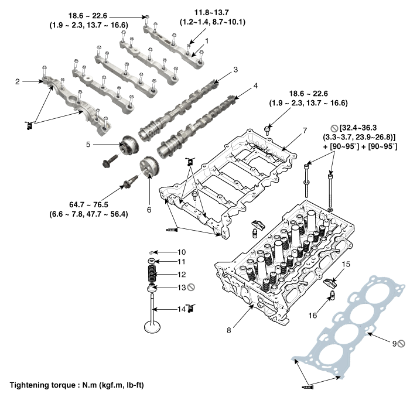

# Cabeçote — componentes e localização

[Home](../../index.md) / [Manual de Serviço e Reparo](../sportage-482.md) / [Motorização NU](index.md) / Cabeçote — componentes e localização

## Componentes

| 1. Tampa do eixo dos mancais do comando 2. Tampa do rolamento do comando frontal 3. Eixo dos mancais do comando de escape 4. Eixo dos mancais do comando de admissão 5. Montagem do CVVT de escape 6. Montagem do CVVT de admissão | 7. Comando 8. Cabeçote 9. Gasket do cabeçote 10. Bloqueador do retainer 11. Retainer 12. Mola do valvulino | 13. Selo do estilete do valvulino 14. Valvulino 15. Braço de balança 16. Ajustador hidráulico do preenchimento do vão livre (HLA) |
| --- | --- | --- |
