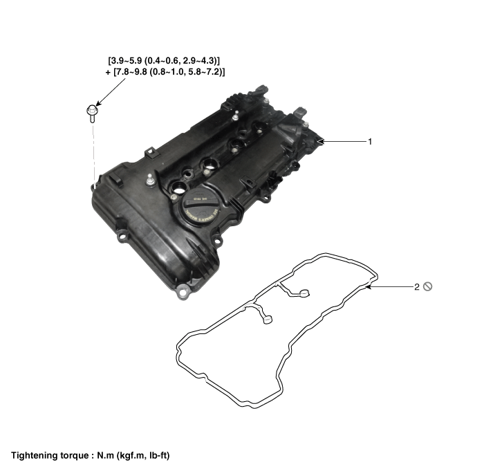

# Tampa do cabeçote — componentes e localização

[Home](../../index.md) / [Manual de Serviço e Reparo](../sportage-482.md) / [Motorização NU](index.md) / Tampa do cabeçote — componentes e localização

## Componentes

| 1. Cobertura do bloco de cilindros | 2. Gasket da cobertura do bloco de cilindros |
| --- | --- |
