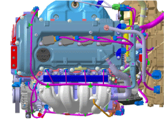
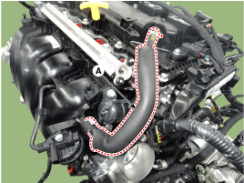
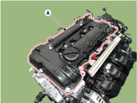
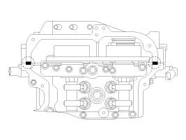
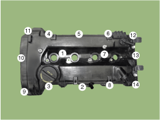

# Tampa do cabeçote — procedimentos

[Home](../../index.md) / [Manual de Serviço e Reparo](../sportage-482.md) / [Motorização NU](index.md) / Tampa do cabeçote — procedimentos

## Remoção

> **Nota**
>
> - Use cobertores de capô para evitar danos às superfícies pintadas.
> - Para evitar danos, desconecte cuidadosamente os conectores das bobinas, segurando a parte do conectores.

| • Marque todos os cabos e mangueiras para evitar conexões incorretas. |  |
| --- | --- |
| • | Marque todos os cabos e mangueiras para evitar conexões incorretas. |

1. Remova o capô do motor.

   (Consulte Montagem do Motor e Caixa de Transmissão - "Capô do Motor")

2. Desconecte o terminal negativo da bateria.

3. Desconecte os conectores e os engates das mangueiras e remova os engates ao redor da cobertura do bloco de cilindros.

   

4. Remova o dutamento de ar e a assemblagem de limpador de ar.

   (Consulte Sistema de Admissão e Exaustão - "Limpador de Ar")

5. Remova as bobinas de ignição.

   (Consulte Sistema Elétrico do Motor - "Bobinas de Ignição")

6. Remova o indicador do nível do óleo do motor.

   (Consulte Sistema de Lubrificação - "Indicador do Nível do Óleo & Tubos")

7. Desconecte a mangueira de ventilação primária do casco do motor (A).

   

8. Remova a cobertura do bloco de cilindros (A).

   

   > **Nota**
   >
   > - Desafine os parafusos na sequência indicada.

## Instalação

1. Instale a tampa do cabeçote.

   (1) Antes de montar a tampa do cabeçote, é necessário remover o selante endurecido localizado na tampa do cabeçote e na junta entre a cobertura da corrente de tempo e o carregador do pistão.

   (2) Aplicar óleo de motor na parte lip da junta de selo na cobertura e na superfície externa das tubos de pino de estaca.

   (3) Após aplicar o selante na junta entre a cobertura da corrente de tempo e o carregador do pistão, a montagem deve ser realizada dentro de 5 minutos.

    ```
    Largura do anel: 2,0 ~ 3,0 mm (0,08 ~ 0,12 in.)
    Selante: Threebond 1217H ou equivalente
    ```

    

   (4) Instale a cobertura do cabeçote, apertando as varetas de fixação em várias etapas, na sequência mostrada.

    ```
    Torque de aperto
    1ª etapa:
    3,9 ~ 5,9 N.m (0,4 ~ 0,6 kgf.m, 2,9 ~ 4,3 lb-ft)
    2ª etapa:
    7,8 ~ 9,8 N.m (0,8 ~ 1,0 kgf.m, 5,8 ~ 7,2 lb-ft)
    ```

    

   > **Nota**
   >
   > - Não reutilize a borracha de vedação da tampa do cabeçote.
   > - Antes de instalar a tampa do cabeçote, verifique se a borracha de vedação da tampa do cabeçote não se separou do rebaixo da borracha de vedação da tampa do cabeçote.
   > - Não realize o teste de pressão ou o funcionamento do motor nos 30 minutos após a montagem da tampa do cabeçote.

2. Instale as outras peças na ordem inversa à do desmontagem.
