# Cabeçote — procedimentos

[Home](../../index.md) / [Manual de Serviço e Reparo](../sportage-482.md) / [Motorização NU](index.md) / Cabeçote — procedimentos

## Remoção

A remoção do motor não é necessária para este procedimento.

> **Nota**
>
> - Use coberturas de para-choque para evitar danos às superfícies pintadas.
> - Para evitar danos ao cabeçote do cilindro, aguarde que a temperatura do líquido de resfriamento do motor caia abaixo da temperatura normal (20°C [68°F]) antes de removê-lo.
> - Ao manipular uma borracha de vedação metálica, tome cuidado para não dobrar a borracha ou danificar a superfície de contato da borracha.
> - Para evitar danos, desconecte cuidadosamente os conectores de fiação mantendo a parte do conectador.

| • Marque todos os fios e mangueiras para evitar a conexão incorreta. • Alinhe a roda do alinhador do buxo para que o pistão nº 1 esteja no TDC (Top Dead Center). |  |
| --- | --- |
| • | Marque todos os fios e mangueiras para evitar a conexão incorreta. |
| • | Alinhe a roda do alinhador do buxo para que o pistão nº 1 esteja no TDC (Top Dead Center). |

1. Remova a capa do motor.

   (Consulte Montagem do Motor e Transaxle - "Capa do Motor")

2. Remova o tubo de ar e a limpa-área.

   (Consulte Sistema de Admissão e Emissão - "Limpa-área")

3. Remova a bateria.

   (Consulte Sistema Elétrico do Motor - "Bateria")

4. Remova o ECM (Module de Controle do Motor).

   (Consulte Sistema de Controle do Motor / Sistema de Combustível - "Module de Controle do Motor (ECM)")

5. Remova a prateleira da bateria.

   (Consulte Sistema Elétrico do Motor - "Bateria")

6. Remova a capa inferior do compartimento do motor.

   (Consulte Montagem do Motor e Transaxle - "Capa Inferior do Compartimento do Motor")

7. Descarte o líquido de resfriamento.

   (Consulte Sistema de Resfriamento - "Líquido de Resfriamento")

8. Desconecte a mangueira de combustível (A) e a mangueira do solenoide de purga (PCSV) (B).

   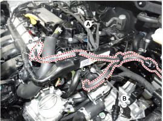

9. Remova a mangueira de vácuo (A).

   ```
   Torque de aperto:
   9,8 ~ 11,8 N.m (1,0 ~ 1,2 kgf.m, 7,2 ~ 8,7 lb-ft)
   ```

   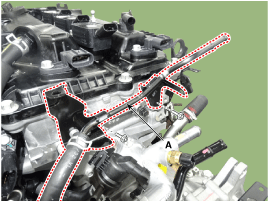

10. Remova o condensador (A).

    ```
    Torque de aperto:
    9,8 ~ 11,8 N.m (1,0 ~ 1,2 kgf.m, 7,2 ~ 8,7 lb-ft)
    ```

    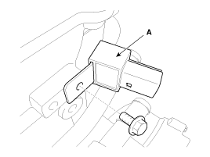

11. Remova o suporte do solenoide de purga (PCSV) (A).

    ```
    Torque de aperto:
    9,8 ~ 11,8 N.m (1,0 ~ 1,2 kgf.m, 7,2 ~ 8,7 lb-ft)
    ```

    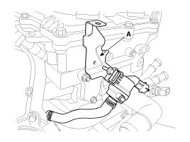

12. Remova a mangueira de entrega.

    (Consulte Sistema de Controle do Motor / Sistema de Combustível - "Mangueira de Entrega")

13. Remova a capa do cabeçote do cilindro.

    (Consulte Montagem do Cabeçote do Cilindro - "Capa do Cabeçote do Cilindro")

14. Remova a corrente de sincronização.

    (Consulte Sistema de Sincronização - "Corrente de Sincronização")

15. Remova o manifold de escape.

    (Consulte Sistema de Admissão e Emissão - "Manifold de Escape")

16. Remova o manifold de admissão.

    (Consulte Sistema de Admissão e Emissão - "Manifold de Admissão")

17. Remova a montagem de controle de temperatura da água.

    (Consulte Sistema de Resfriamento - "Montagem de Controle de Temperatura da Água")

18. Remova a mangueira do aquecedor.

    (Consulte Sistema de Resfriamento - "Termostato")

19. Remova a montagem de CVVT de admissão (A) e de escape (B).

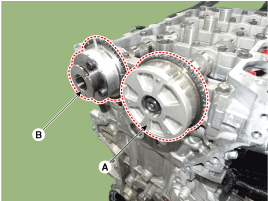

| • Quando remover o parafuso da montagem CVVT, segure o buxo com uma chave para prevenir a rotação do buxo. | |
| --- | --- |
| • | Quando remover o parafuso da montagem CVVT, segure o buxo com uma chave para prevenir a rotação do buxo. |

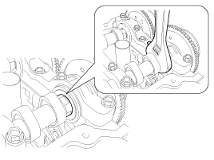

20. Remova o buxo.

   (1) Remova a tampa do buxo (A) desafivelando os parafusos na sequência indicada.

    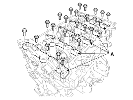

    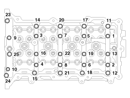

   (2) Remova os buxos (A).

    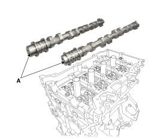

21. Remova o suporte do buxo (A).

    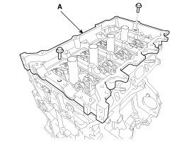

22. Remova o regulador hidráulico de intervalo de válvulas (HLA) (A) e o braço de movimento (B).

    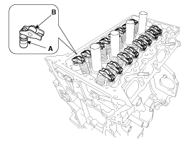

    | • O HLA e o braço de movimento devem ser mantidos em pares durante o armazenamento após a remoção e reinstalação. | |
    | --- | --- |
    | • | O HLA e o braço de movimento devem ser mantidos em pares durante o armazenamento após a remoção e reinstalação. |

23. Remova o adaptador de controle de óleo do cabeçote (A) com a borracha (B).

    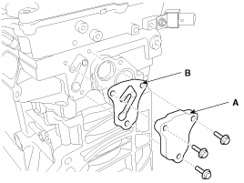

24. Remova o válvula de controle de óleo de admissão (OCV) (A).

    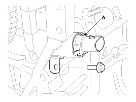

25. Remova a válvula de controle de óleo de escape (OCV) (A).

    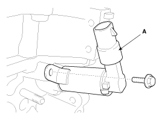

26. Remova o amortecedor de suspensão traseira (A).

    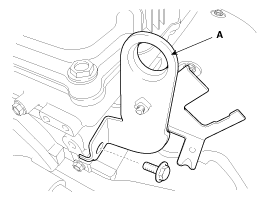

27. Remova as bobinas de ignição.

   (Consulte o Sistema Elétrico do Motor - "Bobina de Ignição")

28. Remova o cabeçote do cilindro.

   (1) Usando uma chave de fenda (12PT), desafivelar e remover os parafusos do cabeçote de forma uniforme, em várias passadas, na sequência indicada.

    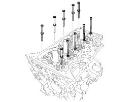

    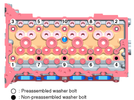

    > **Nota**
    >
    > - A warpage ou fissuras do cabeçote podem ocorrer se os parafusos forem removidos em uma ordem incorreta.

   (2) Levante o cabeçote do cilindro (A) das guias no bloco do cilindro e coloque o cabeçote do cilindro em blocos de madeira em uma bancada.

    > **Nota**
    >
    > - Seja cuidadoso para não danificar as superfícies de contato do cabeçote do cilindro e do bloco do cilindro.

   (3) Remova a borracha do cabeçote do cilindro (B).

    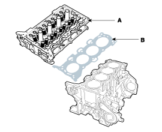

## Desmontagem

> **Nota**
>
> - Identifique as válvulas e as molas das válvulas conforme forem removidas para que cada item possa ser reinstalado em sua posição original.

1. Remova as válvulas.

   (1) Usando o SST (09222-3K000, 09222-2A100), comprima a mola da válvula e remova o travante do bloqueio (A).

    | • Quando instalar o SST, insira o suporte frontal (A) diretamente no orifício do parafuso na alça do cilindro. | |
    | --- | --- |
    | • | Quando instalar o SST, insira o suporte frontal (A) diretamente no orifício do parafuso na alça do cilindro. |

    > **Nota**
    >
    > - Não comprima o travante da válvula mais do que 12 mm (0,47 in.).

   (2) Remova o travante da mola (B).

   (3) Remova a mola da válvula (C).

   (4) Remova a válvula (D).

   (5) Usando pinças de ponta, remova o selo do estilete da válvula (E).

    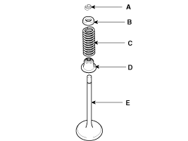

    > **Nota**
    >
    > - Não reutilize os selos do estilete da válvula.

## Inspeção

Cabeça do Cilindro

1. Inspeção para planímetros.

   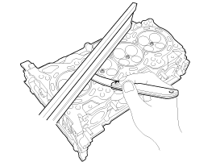

   Usando um guia de precisão e uma régua-filheta, medir a superfície de contato do bloco do cilindro e dos manifolds para verificar a distorção.

   ```
   Planímetro da superfície do anel de vedação da cabeça do cilindro:
   Menos de 0.05 mm (0.0020 in.) para a área total
   Menos de 0.02 mm (0.0008 in.) para uma seção de 100 mm (3.9370 in.) x 100 mm (3.9370 in.)
   ```

   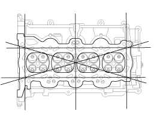

   ```
   Planímetro da superfície de montagem do manifold:
   Menos de 0.10 mm (0.0039 in.)
   ```

   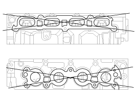

2. Inspeção para rachaduras.

   Verifique o câmara de combustão, os portos de admissão, os portos de escape e a superfície do bloco do cilindro para rachaduras. Se houver rachaduras, substitua a cabeça do cilindro.

Valvula e Mola da Valvula

1. Inspeção das estacas das válvulas e das guias.

   (1) Usando um calibrador, medir o diâmetro interno da guia da válvula.

    ```
    Diâmetro interno da guia da válvula
    Admissão: 5.500 ~ 5.512 mm (0.21654 ~ 0.21701 in.)
    Escape: 5.500 ~ 5.512 mm (0.21654 ~ 0.21701 in.)
    ```

    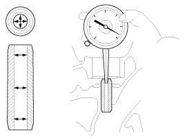

   (2) Usando um micrômetro, medir o diâmetro da estaca da válvula.

    ```
    Diâmetro externo da estaca da válvula
    Admissão: 5.465 ~ 5.480 mm (0.21516 ~ 0.21575 in.)
    Escape: 5.458 ~ 5.470 mm (0.21488 ~ 0.21535 in.)
    ```

    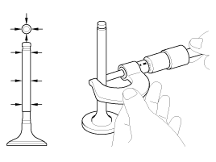

   (3) Subtrair a medida do diâmetro da estaca da medida do diâmetro interno da guia da válvula.

    Se a clearance for maior que a especificação, substitua a válvula ou a cabeça do cilindro.

    ```
    Clearance estaca-guia
    [Padrão]
    Admissão: 0.020 ~ 0.047 mm (0.00079 ~ 0.00185 in.)
    Escape: 0.030 ~ 0.054 mm (0.00118 ~ 0.00213 in.)
    ```

2. Inspeção das válvulas.

   (1) Verifique se a válvula foi aferida para o ângulo correto da face da válvula.

   (2) Verifique a superfície da válvula para desgaste.

    Se a face da válvula estiver desgastada, substitua a válvula.

   (3) Verifique a espessura do margem da cabeça da válvula.

    Se a espessura do margem for menor que a especificação, substitua a válvula.

    ```
    Margem
    [Padrão]
    Admissão: 1.30 mm (0.0512 in.)
    Escape: 1.26 mm (0.0496 in.)
    ```

    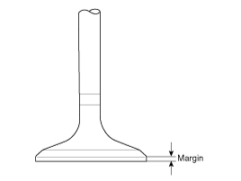

   (4) Verifique a superfície do topo da estaca da válvula para desgaste.

    Se o topo da estaca da válvula estiver desgastado, substitua a válvula.

3. Inspeção das guias das válvulas e das guias.

   (1) Verifique a guia da válvula para evidências de superaquecimento e contato inadequado com a face da válvula.

    Se a guia da válvula estiver desgastada, substitua a cabeça do cilindro.

(2) Verifique o guia da válvula para desgaste. Se o guia da válvula estiver desgastado, substitua a cabeça do cilindro.

4. Inspeção das molas das válvulas.

   (1) Usando um quadrado de aço, medir o desvio de ângulo das molas das válvulas.

   (2) Usando um calibrador, medir a comprimento livre das molas das válvulas.

    Se o comprimento livre não for conforme especificado, substitua a mola da válvula.

    ```
    Mola da válvula
    [Padrão]
    Comprimento livre: 45,93 mm (1,8083 in.)
    Carga: 19,6 ± 1,0 kg / 37,0 mm
    (43,21 ± 2,20 lb / 1,0630 in.)
    45,7 ± 1,8 kg / 27,0 mm
    (100,75 ± 3,97 lb / 1,0630 in.)
    Desvio de ângulo: Menos de 1,5°
    ```

    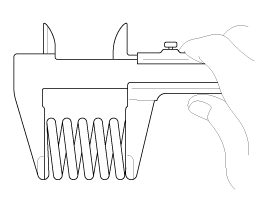

Ajustador Hidráulico de Aparo de Válvulas (HLA)

Com o HLA cheio de óleo do motor, segure A e pressione B manualmente.

Se B se mover, substitua o HLA.

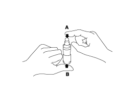

| Problema | Causa possível | Ação |
| --- | --- | --- |
| 1. Som temporário ao ligar o motor frio | Normal | Esse som desaparecerá após o óleo do motor atingir a pressão normal. |
| 2. Som contínuo ao ligar o motor após estacionar por mais de 48 horas | Vazamento do câmara de alta pressão do HLA, permitindo a entrada de ar | O som desaparecerá em 15 minutos quando o motor roda a 2000-3000 rpm. Se não desaparecer, referir-se ao passo 7 abaixo. |
| 3. Som contínuo ao ligar o motor após a reconstrução da cabeça do cilindro | Nível de óleo insuficiente na galeria de óleo da cabeça do cilindro |  |
| 4. Som contínuo ao ligar o motor após o motor ser submetido a um acionamento excessivo pelo motor de partida ou cinto | • Vazamento da câmara de alta pressão do HLA, permitindo a entrada de ar • Nível de óleo insuficiente no HLA |  |
| • | Vazamento da câmara de alta pressão do HLA, permitindo a entrada de ar |  |
| • | Nível de óleo insuficiente no HLA |  |
| 5. Som contínuo ao ligar o motor após a substituição do HLA | • Não ligue o motor a uma velocidade superior a 3000 rpm, pois isso pode danificar o HLA. |  |
| • Não ligue o motor a uma velocidade superior a 3000 rpm, pois isso pode danificar o HLA. |  |  |
| • | Não ligue o motor a uma velocidade superior a 3000 rpm, pois isso pode danificar o HLA. |  |
| 6. Som contínuo durante o idl após uma alta velocidade do motor | Nível de óleo do motor muito alto ou muito baixo | • Verifique o nível de óleo. • Descarte ou adicione óleo conforme necessário. |
| • | Verifique o nível de óleo. |  |
| • | Descarte ou adicione óleo conforme necessário. |  |
| Excesso de ar na oleo a alta velocidade do motor | Verifique o sistema de suprimento de óleo. |  |
| Óleo deteriorado | Verifique a qualidade do óleo. Se deteriorado, substitua pelo tipo especificado. |  |
| 7. Som continua por mais de 15 minutos | Baixa pressão de óleo | Verifique a pressão de óleo e o sistema de suprimento de óleo de cada parte do motor. |
| Falha no HLA | Remova a tampa da cabeça do cilindro e pressione o HLA manualmente. Se se mover, substitua o HLA. |  |

## Reajuste

> **Nota**
>
> - Limpe todos os componentes a serem montados.
> - Antes de instalar os componentes, aplique óleo de motor fresco em todas as superfícies deslizantes e rotativas.
> - Substitua as selas de óleo por novas.

1. Monte as válvulas.

   (1) Usando o SST (09222-2E000), empurre uma nova selagem do estribo (A).

    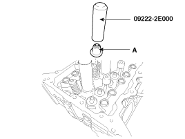

    > **Nota**
    >
    > - Não reutilize selagens do estribo usadas.
    > - Uma instalação incorreta da selagem pode resultar em vazamento de óleo pela guia da válvula.

   (2) Monte a válvula, a mola da válvula e o retainer da mola.

    > **Nota**
    >
    > - Posicione as molas da válvula de modo que o lado revestido com enamel
    fique voltado para o retainer da mola e, em seguida, instale o retainer.

   (3) Usando o SST (09222-3K000, 09222-2A100), comprima a mola e instale os locks do retainer.

    Antes de liberar o compressor da mola, assegure-se de que os locks do retainer estejam corretamente em seu lugar após pressionar e liberar o manopla do compressor 2 ~ 3 vezes.

    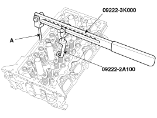

    | • Quando instalar o SST, insira o suporte frontal (A) diretamente no orifício do parafuso na cabeça do cilindro. | |
    | --- | --- |
    | • | Quando instalar o SST, insira o suporte frontal (A) diretamente no orifício do parafuso na cabeça do cilindro. |

    > **Nota**
    >
    > - Não pressione o retainer da válvula mais do que 12 mm (0,47 in.).

## Instalação

> **Nota**
>
> - Limpe todos os componentes a serem montados.
> - Sempre use novas borrachas de vedação do cabeçote do cilindro e do manifolds.
> - Sempre use novos parafusos de vedação do cabeçote do cilindro.
> - A borracha de vedação do cabeçote do cilindro é uma borracha metálica. Cuide para não dobrá-la.
> - Rotacione o eixo do crankshaft para posicionar o pistão nº1 no topo (Top dead center) na fase de compressão.

1. Instale a borracha de vedação do cabeçote do cilindro (B) no bloco do motor.

   (1) Remova o selante endurecido, o óleo, a poeira, a umidade e os materiais estranhos prejudiciais do bloco do motor e do cabeçote do motor.

   (2) Aplicar gasket líquido na borda do bloco do motor.

   (3) Instale a borracha de vedação do cabeçote do cilindro com as pinhas do bloco do motor.

   (4) Aplicar gasket líquido na borda da borracha de vedação do cabeçote do cilindro.

    | • Aplicar gasket líquido na borda do bloco do motor e da borracha de vedação do cabeçote do cilindro. | |
    | --- | --- |
    | • | Aplicar gasket líquido na borda do bloco do motor e da borracha de vedação do cabeçote do cilindro. |

    ```
    Selante:
    Threebond 1217H ou equivalente
    ```

    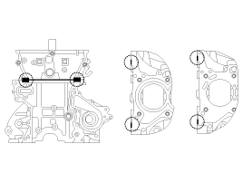

    > **Nota**
    >
    > - Monte a borracha de vedação do cabeçote do cilindro e o cabeçote do motor dentro de 5 minutos após a aplicação do selante.

2. Posicione o cabeçote do motor (A) cuidadosamente para proteger o dano à borracha de vedação durante a instalação.

   

3. Instale os parafusos de vedação do cabeçote do motor com as pinhas.

   Usando SST (09221-4A000), instale e aperte os 10 parafusos de vedação do cabeçote do motor, em várias passadas, na sequência mostrada.

   ```
   Torque de aperto
   1ª etapa:
   32,4 ~ 36,3 N.m (3,3 ~ 3,7 kgf.m, 23,9 ~ 26,8 lb-ft)
   2ª etapa: 90~95°
   3ª etapa: 90~95°
   ```

   

   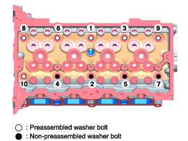

   > **Nota**
   >
   > - Não reutilize os parafusos de vedação do cabeçote do motor.
   > - Não aplique óleo do motor nos fios dos parafusos para obter o torque correto.
   > - Remova o selante extrudido dentro de 5 minutos após a instalação dos parafusos de vedação do cabeçote do motor.
   > - O teste de pressão ou a operação do motor não devem ser realizados dentro de 30 minutos após a instalação dos parafusos de vedação do cabeçote do motor.
   > - Cuide para não mudar a posição de instalação das pinhas pré-ajustadas e das pinhas não pré-ajustadas.
   > - Ao instalar a pinha das pinhas não pré-ajustadas, a parte redonda e a entalhe das pinhas devem estar voltadas para cima.

   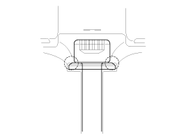

4. Instale o amortecedor traseiro do motor (A).

   ```
   Torque de aperto:
   34,3 ~ 39,2 N.m (3,5 ~ 4,0 kgf.m, 25,3 ~ 28,9 lb-ft)
   ```

   

5. Instale o valve de controle de óleo de escape (OCV) (A).

   ```
   Torque de aperto:
   9,8 ~ 11,8 N.m (1,0 ~ 1,2 kgf.m, 7,2 ~ 8,7 lb-ft)
   ```
