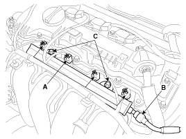
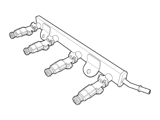

# Flauta de combustível — procedimentos

[Home](../../index.md) / [Manual de Serviço e Reparo](../sportage-482.md) / [Motorização NU](index.md) / Flauta de combustível — procedimentos

## Remoção

1. Desligue a ignição e desconecte o cabo negativo (-) da bateria.

2. Libere a pressão residual na linha de combustível.

   (Consulte Sistema de Entrega de Combustível - "Libere a Pressão Residual na Linha de Combustível")

   > **Cuidado**
   >
   > - Ao remover o relé do bomba de combustível, um Código de Falha Diagnóstico (CFD) pode ocorrer. Exclua o código com o GDS após a conclusão do trabalho de "Liberação da Pressão Residual na Linha de Combustível".

3. Desconecte o conectador do injetor (A).

4. Desconecte o quick-connector do tubo de alimentação de combustível (B).

5. Remova a viga de fixação (C), e então remova a montagem do tubo de entrega e injetor do motor.

   

   

## Instalação

1. A instalação é o inverso da remoção.

   ```
   Viga de fixação do tubo de entrega:
   18,6 ~ 23,5 N.m (1,9 ~ 2,4 kgf.m, 13,7 ~ 17,4 lb-ft)
   ```
