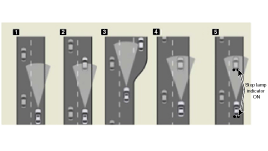

# Kia Sportage SL: Motorização NU / Description and Operation

[Home](../../index.md) / [Kia Sportage SL Service & Repair Manual](../sportage-482.md) / [Motorização NU](index.md) / Description and Operation

## Descrição

O sistema de cruise control inteligente permite que o motorista programar
a velocidade e a distância de seguimento do veículo detectando o veículo à frente sem precisar apertar o pedal do freio e o pedal do acelerador.

1. Controle de velocidade de cruzeiro: O veículo mantém a velocidade selecionada se não houver veículos à frente.

2. Controle de retardação: O veículo desacelera se um veículo à frente for detectado.

3. Controle de distância de seguimento: O veículo mantém a distância de seguimento selecionada.

4. Controle de aceleração: O veículo acelera para a velocidade selecionada se não houver veículos à frente.

   

5. Controle em curvas

   (1) O sensor pode não detectar um veículo à frente ou pode detectar um
    veículo em outras faixas porque o alcance de detecção do sensor é limitado.

   (2) Em curvas, se o veículo equipado com o SCC estiver em alta velocidade, o veículo pode escorregar para fora. Portanto, reduza a velocidade em curvas mesmo se não houver veículos à frente. (Não há controle de freio pelo SCC.)

   (3) Enquanto o veículo segue um veículo à frente em uma estrada reta, se o veículo à frente entrar em uma curva, o veículo equipado com o SCC pode acelerar para seguir o veículo à frente.

   (4) Em curvas, se o veículo à frente seguido estiver fora do alcance, o veículo não acelerará para a velocidade definida e manterá a velocidade de seguimento para prevenir acelerações e desacelerações repetidas. (Se o veículo equipado com o SCC mudar de faixa ou aplicar o pedal do acelerador, o veículo acelerará.)

6. Alarme de advertência

   Se o veículo equipado com o SCC desacelerar porque um veículo à frente desacelerar ou se mover para sua faixa, o alarme operará.

   (1) No caso em que o veículo equipado com o SCC pode desacelerar adequadamente pelo sistema – Sem alarme

   (2) No caso em que o veículo equipado com o SCC não pode desacelerar adequadamente pelo sistema

    A. O indicador no painel piscará e o buzzer de advertência
    será emitido. (O alarme e a desaceleração pelo sistema continuarão até que o pedal do freio seja aplicado.)

   (3) Se o veículo à frente (velocidade do veículo: menor que 30km/h)
    desaparecer na próxima faixa durante o controle de distância de seguimento, o alarme sonoro será emitido e uma mensagem aparecerá. Ajuste a velocidade do seu veículo para veículos ou objetos que podem aparecer repentinamente à frente.

7. Aceleração pelo motorista

   Mesmo que o veículo esteja sendo desacelerado pelo sistema SCC, o veículo pode ser acelerado aplicando o pedal do acelerador. Se o veículo for acelerado acima da velocidade definida, o indicador no painel piscará.

   > **Nota**
   >
   > - Condições de operação do controle de cruzeiro inteligente
   > - Velocidade do veículo de aproximadamente 0 ~ 160km/h (0 ~ 99.4mph)
   > - Transmissão em modo D ou modo Esportivo
   > - Interruptor "ESP OFF" desligado
   > - Interruptor "CRUISE" ligado (indicador CRUISE ligado)

> - Sob as condição acima, ative o sistema de cruzeiro usando o interruptor "SET/–" ou "RES/+".
> - • Condições de desativação do controle de cruzeiro inteligente
> - Interruptor "CRUISE" desligado
> - Interruptor "CANCLE" ligado
> - Pedal do freio aplicado
> - Porta do motorista aberta
> - Velocidade do veículo acima de aproximadamente 170km/h (105mph)
> - Transmissão em N ou P ou R
> - ESP/ TCS / ABS em operação
> - Pedal do acelerador aplicado por mais de 5min
> - Interruptor "ESP OFF" ligado (indicador "ESP OFF" ligado)
> - Freio de estacionamento aplicado
> - Falha no sistema (indicador de advertência ligado)
> - Racha, dano ou instalação incorreta da capa do controle de cruzeiro inteligente (indicador de advertência ligado)

8. Função do controle de cruzeiro

   O motorista pode escolher usar apenas o modo de cruzeiro (função de controle de velocidade) fazendo o seguinte:

   Com o sistema de cruzeiro inteligente ligado (a luz do indicador de cruzeiro estará acesa, mas o sistema não estará ativado), pressione o interruptor de distância por mais de 2 segundos. Os modos "Controle de cruzeiro inteligente (SCC)" e "Controle de cruzeiro (CC)" podem ser selecionados. O controle de velocidade do modo de cruzeiro é o mesmo que o do controle de cruzeiro inteligente.

   Quando usando o modo de cruzeiro, o motorista deve acessar manualmente a distância para outros veículos, pois o sistema não automaticamente freará para diminuir a velocidade de outros veículos.

Interruptor principal de cruzeiro (CRUISE)

   O sistema de cruzeiro inteligente é ativado pressionando o interruptor principal de cruzeiro "ON/OFF". Quando o sistema de cruzeiro inteligente está ativado, o indicador CRUISE no painel de instrumentos acende.

Interruptor de configuração/coast (SET/–)

   O interruptor "SET/–" localizado à direita da coluna do volante tem duas funções.

   Função de configuração - Pressione o interruptor "SET/–" e solte-o na velocidade desejada. A luz SET no painel de instrumentos acenderá. Solte o pedal do acelerador. A velocidade desejada será automaticamente mantida.

   A velocidade de 10 ~ 30km/h (0 ~ 20mph) deve haver um veículo à frente do veículo do motorista. A velocidade-alvo é definida em 30km/h (20mph).

   Função coast - Pressione o interruptor "SET/–" e mantenha-o quando o controle de cruzeiro inteligente estiver ligado. O veículo irá diminuir gradualmente a velocidade. Solte o interruptor na velocidade desejada.

   A velocidade desejada será mantida. Pressione o interruptor "SET/–" e solte-o rapidamente.

   A velocidade de cruzeiro diminuirá em 1.0km/h ou 1.0mph.

> **Nota**
>
> - Se a velocidade do veículo for superior à velocidade definida ao aplicar o acelerador, a velocidade do veículo será a velocidade definida.

o controle de cruzeiro inteligente está ativo. O veículo acelerará gradualmente.
Solte o interruptor na velocidade desejada. A velocidade desejada será mantida.

Pressione o interruptor "RES/+" e solte rapidamente. A velocidade de cruzeiro aumentará em 1,0km/h ou 1,0mph.

Interruptor de cancelamento (CANCEL)

O sistema de controle de cruzeiro é temporariamente desativado pressionando o interruptor "CANCEL".

Interruptor de controle de distância de seguidor

Este sistema auxilia você a definir a distância do veículo à frente e manter a distância selecionada mesmo sem pressionar o acelerador ou o pedal do freio.

Selecione a distância apropriada de acordo com as condições de tráfego e a velocidade do veículo.

Cada vez que o botão for pressionado, a distância muda conforme segue:

Ex) Distância 4 > Distância 3 > Distância 2 > Distância 1 > Distância 4

Se você estiver dirigindo a 90km/h (55,9mph), a distância será mantida da seguinte forma;

Distância 4 - aproximadamente 52,5m (172,2ft)

Distância 3 - aproximadamente 40m (131,2ft)

Distância 2 - aproximadamente 32,5m (106,6ft)

Distância 1 - aproximadamente 25m (82,0ft)

A distância de cada estágio é alterada de acordo com a velocidade do veículo à frente.

Exibição no cluster

| Exibição | Descrição |
| --- | --- |
|  | Distância 1 - com um veículo à frente |
|  | Distância 2 - com um veículo à frente |
|  | Distância 3 - com um veículo à frente |
|  | Distância 4 - com um veículo à frente |
|  | Falha no sistema SCC |
