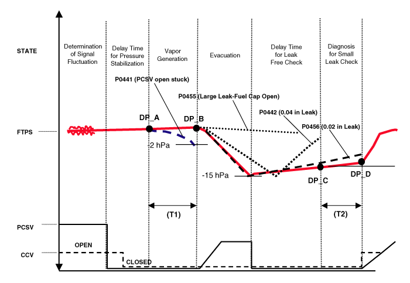
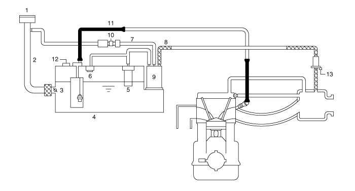

# Kia Sportage SL: Motorização NU / Description and Operation

[Home](../../index.md) / [Kia Sportage SL Service & Repair Manual](../sportage-482.md) / [Motorização NU](index.md) / Description and Operation

## Descrição

O Sistema de Controle de Emissão Evaporativa previne a vaporização do
combustível armazenado na tanque de combustível na atmosfera. Quando o
combustível evapora no tanque, o vapor passa através de mangueiras ou
tubos para uma canister preenchido com carvão.

A canister temporariamente armazena o vapor no carvão. O
ECM controlará o sistema para aspirar o vapor coletado para as câmaras de
combustão durante certas condições de operação. O vácuo do manifólio do
motor é usado para aspirar o vapor para o manifólio de admissão.

## Operação

Monitoramento do Sistema Evaporativo

Sistema de Controle de Emissão Evaporativo e ORVR

Este sistema consiste em um válvula de enchimento de ventilação, uma
válvula de corte de combustível, uma válvula de dois caminhos (de
pressão/vácuo de alívio), um separador de líquido/vapor do combustível
instalado ao lado do tubo de enchimento, uma canister de carvão
montada sob o membro do chassi da lateral esquerda e o protetor, tubos
e conexões variadas.

Ao abastecer, o ar ambiente é aspirado pelo tubo de enchimento para
evitar a emissão de vapores de combustível no ar. O vapor de combustível
no tanque é então forçado a fluir para a canister através da válvula de
enchimento de ventilação. O separador de líquido/vapor do combustível
isolou o combustível líquido e passou o vapor puro para a canister de
carvão.

Enquanto o motor está em operação, o vapor preso na canister é
aspirado para o manifólio de admissão e então para as câmaras de
combustão do motor. Usando este processo de purga, a canister de
carvão é purgada e recupera sua capacidade de absorção.

| 1. Capa do Tanque de Combustível 2. Tubo de Enchimento do Tanque 3. Válvula de Corte de Combustível 4. Tanque de Combustível 5. Válvula ORVR 6. Válvula de Dois Caminhos e Corte 7. Mangueira de Vapores Evaporativos | 8. Mangueira de Vapores Evaporativos 9. Canister 10. Válvula de Fechamento do Canister (CCV) 11. Linha de Abastecimento de Combustível 12. Sensor de Pressão do Tanque de Combustível (FTPS) 13. Válvula de Solenoide de Controle de Purga (PCSV) |
