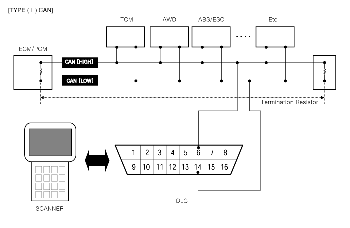
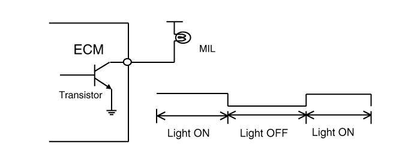

# Descrição e operação

[Home](../../index.md) / [Manual de Serviço do Kia Sportage NU](index.md) / [Sistema de Controle e Sistema de Combustível](nu-engine_control_fuel_system-3018.md) / [Sistema de Controle do Motor](nu-engine_control_system-3023.md) / Descrição e operação

## Revisão OBD-II

1. Visão Geral

O Conselho de Recursos Ambientais da Califórnia (CARB) começou a regulamentar a Diagnóstico a bordo (OBD) para veículos vendidos na Califórnia a partir do modelo de 1988. A primeira fase, OBD-I, exigiu o monitoramento do sistema de medição de combustível, do sistema de Recirculação de Gases de Emissão (EGR) e de outros componentes relacionados à emissão. O Lâmpada de Indicação de Falha (MIL) foi exigido para acender e alertar o motorista sobre a falha e a necessidade de reparo do sistema de controle de emissões. Associado ao MIL estava um código de falha ou Código de Problema Diagnóstico (DTC) identificando a área específica da falha.

O sistema OBD foi proposto pelo CARB para melhorar a qualidade do ar ao identificar veículos que excedem os padrões de emissão. A aprovação da Emenda à Lei Federal de Aire Limpo de 1990 também incentivou o Agente de Proteção Ambiental (EPA) a desenvolver requisitos de Diagnóstico a bordo. As regulamentações OBD-II do CARB foram adotadas até 1999, quando as regulamentações federais foram utilizadas.

O sistema OBD-II atende aos requisitos governamentais ao monitorar o sistema de controle de emissões. Quando um sistema ou componente excede o limite de emissão ou opera fora da tolerância, um DTC será armazenado e o MIL acendido.

O executivo de diagnóstico é um programa de computador no Módulo de Controle do Motor do Motor (ECM) ou Módulo de Controle do Potência (PCM) que coordena o sistema de auto-monitoramento OBD-II. Este programa controla todos os monitores e interações, operação do DTC e MIL, dados de quadro congelado e interface com ferramentas de escaneamento.

Dados de quadro congelado descrevem condições de motor armazenadas, como estado do motor, estado do controle do combustível, ignição, RPM, carga e status quente no momento em que a primeira falha é detectada. Condições anteriormente armazenadas serão substituídas apenas se uma falha de combustível ou de desencalque for detectada. Esses dados são acessíveis com a ferramenta de escaneamento para auxiliar no reparo do veículo.

O centro do sistema OBD-II é um microprocessador chamado Módulo de Controle do Motor (ECM) ou Módulo de Controle do Potência (PCM).

O ECM ou PCM recebe entrada de sensores e outros componentes eletrônicos (interruptores, relés e outros) com base em informações recebidas e programadas em sua memória (memória de acesso aleatório com manutenção do estado, entre outros), o ECM ou PCM gera sinais de saída para controlar relés, solenóides e atuadores.

2. Configuração de hardware e termos relacionados

1) GST (Ferramenta de escaneamento genérica)

2) MIL (Lâmpada de Indicação de Falha) - Atividade do MIL por transistor

A Lâmpada de Indicação de Falha (MIL) está conectada entre o terminal da Lâmpada de Indicação de Falha no ECM ou PCM e a alimentação da bateria (amplificador de coletor aberto).

Em quase todos os carros, o MIL será instalado no painel de instrumentos. O amplificador da lâmpada não pode ser danificado por curto-circuito.

Lâmpadas com dissipação de energia muito maior do que a dissipação total do MIL e da lâmpada no teste podem causar indicação de falha.

? Ao ligar o veículo e a rotação do motor (RPM) < MIN. RPM, a MIL é acionada para uma verificação ótica pelo motorista.

3) Iluminação da MIL

Quando o ECM ou PCM detectar uma falha relacionada à emissão durante o primeiro ciclo de condução, os códigos de diagnóstico (DTC) e os dados do motor são armazenados na memória de quadro de congelamento. A MIL é iluminada apenas quando o ECM ou PCM detectar a mesma falha relacionada ao DTC em dois ciclos de condução consecutivos.

4) Exclusão da MIL

? Falhas de Descompressão e Sistema de Combustível:

Para falhas de descompressão ou sistema de combustível, a MIL pode ser excluída se a mesma falha não se repetir durante a monitorização em três ciclos de condução subsequentes e consecutivos em que as condições forem semelhantes às sob as quais a falha foi detectada pela primeira vez.

? Todas as Outras Falhas:

Para todas as outras falhas, a MIL pode ser apagada após três ciclos de condução subsequentes em que o sistema de monitorização responsável pela iluminação da MIL funciona sem detectar a falha e se nenhuma outra falha foi identificada que possa independentemente iluminar a MIL de acordo com os requisitos acima.

5) Exclusão de um código de falha

O sistema de diagnóstico pode excluir um código de falha se a mesma falha não for registrada novamente em pelo menos 40 ciclos de aquecimento do motor e a MIL não estiver iluminada para esse código de falha.

6) Linha de Comunicação (CAN)

| • | Topologia de Rede: Estrutura de linha (bus) |
| --- | --- |

| • | Condução: Fio duplo enrolado |
| --- | --- |

| • | Comprimento do cabo DLC fora do veículo: Máx. 5m |
| --- | --- |

| • | Taxa de Transferência de Dados |
| --- | --- |

| - | Diagnóstico: 500 kbps |
| --- | --- |

| - | Modo de Serviço (Atualização, Escrita do VIN): 500 ou 1 Mbps) |
| --- | --- |

7) Ciclo de condução

Um ciclo de condução consiste em ligar o motor e desligá-lo.

8) Ciclo de aquecimento

Um ciclo de aquecimento significa uma operação do veículo suficiente para que a temperatura do líquido de resfriamento do motor tenha aumentado em pelo menos 40 graus Fahrenheit a partir do início do motor e atinja uma temperatura mínima de pelo menos 160 graus Fahrenheit.

9) Ciclo de viagem

Uma viagem significa a operação do veículo (seguida de um período de desligamento do motor) de duração e de modo de condução tal que todos os componentes e sistemas sejam monitorados pelo menos uma vez pelo sistema de diagnóstico, exceto a eficiência do catalisador ou a monitorização do sistema evaporativo quando uma verificação de velocidade constante é usada, sujeito à limitação de que todas as condições definidas pelo fabricante para o monitoramento da viagem devem ser encontradas pelo menos uma vez no primeiro ciclo de partida do motor durante o ciclo FTP aplicável.

10) Formato de DTC

| • | Código de Falha de Diagnóstico (SAE J2012) |
| --- | --- |

| • | Os DTCs utilizados em veículos OBD-II começam com uma letra e são seguidos por quatro números. |
| --- | --- |

A letra no início do DTC identifica a função do dispositivo monitorado que falhou. Uma "P" indica um dispositivo de potência, "C" indica um dispositivo de chassis. "B" é para um dispositivo do corpo e "U" indica um código de rede ou de ligação de dados. O primeiro número

indica se o código é genérico (comum a todos os fabricantes) ou se é específico do fabricante. Um "0" e "2" indicam genérico, "1" indica específico do fabricante. O segundo número indica o sistema afetado com um número entre 1 e 7.

A seguir está uma lista mostrando os números atribuídos a cada sistema.

1. Medição de combustível e ar

2. Medição de combustível e ar (apenas circuito de injetor malfuncionante)

3. Sistema de ignição ou falha de preenchimento

4. Controles auxiliares de emissão

5. Controles de velocidade do veículo e sistema de controle de idle

6. Circuitos de saída do computador

7. Transmissão

Os últimos dois números do DTC indicam o componente ou seção do sistema onde ocorreu o problema.

11) Dados de quadro congelado

Quando um evento de quadro congelado é disparado por um DTC relacionado à emissão, o ECM ou PCM armazena diversas informações do veículo como eram no momento em que ocorreu o defeito. O número do DTC junto com os dados do motor podem ser úteis para auxiliar o técnico na localização da causa do defeito. Uma vez que os dados da primeira ocorrência do DTC durante o ciclo de condução são armazenados na memória de quadro congelado, eles permanecerão lá mesmo quando o defeito ocorrer novamente (segundo ciclo de condução) e a MIL for acionada.

| • | Lista de Dados de Quadro Congelado |
| --- | --- |

| 1) | Valor de Carga Calculada |
| --- | --- |

| 2) | Velocidade do Motor |
| --- | --- |

| 3) | Ajuste de Combustível |
| --- | --- |

| 4) | Pressão de Combustível (se disponível) |
| --- | --- |

| 5) | Velocidade do Veículo (se disponível) |
| --- | --- |

| 6) | Temperatura do Radiador de Óleo |
| --- | --- |

| 7) | Pressão do Manifold de Admissão (se disponível) |
| --- | --- |

| 8) | Operação em loop fechado ou aberto |
| --- | --- |

| 9) | Código de falha |
| --- | --- |

3. Testes de prontidão do sistema OBD-II

1) Monitoramento do catalisador

O monitoramento da eficiência do catalisador é uma estratégia de teste automático dentro do ECM ou PCM que usa o Sensor de Óxido Quente (HO2S) downstream para determinar quando um catalisador caiu abaixo do nível mínimo de eficácia em sua capacidade de controlar as emissões de exaustão.

2) Monitoramento de preenchimento

Preenchimento é definido como a falta de combinação correta no cilindro devido à falta de chama, medição inadequada de combustível ou compressão inadequada. Qualquer combustão que não ocorra no cilindro no momento certo também é considerada preenchimento. O monitoramento de preenchimento detecta preenchimentos causados por falhas de combustível, ignição ou causados mecanicamente. O objetivo é proteger o catalisador de danos permanentes e alertar o cliente sobre uma falha de emissão ou uma falha de inspeção/mantimento pelo acionamento da MIL. Quando um preenchimento é detectado, um software especial chamado dados de quadro congelado é ativado. Os dados de quadro congelado capturam o estado de operação do veículo quando um defeito é detectado pela estratégia de monitoramento de preenchimento.

3) Monitoramento do sistema de combustível

O monitoramento do sistema de combustível é uma estratégia de teste automático dentro do ECM ou PCM que monitora a tabela adaptativa de combustível. O sistema de controle de combustível usa a tabela adaptativa de combustível para compensar as variações normais dos componentes do sistema de combustível causadas pelo desgaste ou envelhecimento. Durante o funcionamento normal

vehicle operation, se o sistema de combustível parecer desviado para baixo ou para cima, a tabela de valores adaptativos ajustará as cálculos de entrega de combustível para remover o desvio.

4) Monitoramento do sistema de resfriamento do motor

O monitoramento do sistema de resfriamento é uma estratégia de teste automático dentro do ECM ou PCM que monitora o ECTS (Sensor de Temperatura do Coolante do Motor) e o termostato sobre a continuidade do circuito, o intervalo de saída, e os erros de falha.

5) Monitoramento do sensor O2

As regras OBD-II exigem o monitoramento do sensor O2 aquecido (H2OS) upstream para detectar se a deterioração do sensor excedeu os limites. Um sensor adicional HO2S está localizado downstream do Conversor de Três Vias Quente de Aquecimento (WU-TWC) para determinar a eficiência do catalisador.

Apesar do sensor H2OS downstream ser similar ao usado para controle de combustível, ele funciona de forma diferente. O sensor HO2S downstream é monitorado para determinar se uma tensão é gerada. Essa tensão é comparada a um intervalo de tensão calibrado aceitável.

6) Monitoramento do sistema de emissões evaporativas

O monitoramento EVAP. é uma estratégia de teste automático dentro do ECM ou PCM que testa a integridade do sistema EVAP.. O sistema evaporativo completo detecta uma fuga ou fugas que acumulativamente são maiores ou iguais a uma fuga causada por uma orifício de 0,040 polegadas e 0,020 polegadas de diâmetro.

7) Monitoramento do sistema de ar condicionado

O monitoramento do sistema de ar condicionado é uma estratégia de teste automático dentro do ECM ou PCM que monitora a falha de todos os componentes do sistema de ar condicionado quando o ar condicionado está ligado.

8) Monitoramento de componentes completos

O monitoramento de componentes completos é uma estratégia de teste automático dentro do ECM ou PCM que detecta falhas de qualquer componente eletrônico do tração ou sistema que forneça entrada para o ECM ou PCM e não é exclusivamente uma entrada para qualquer outro monitor OBD-II.
