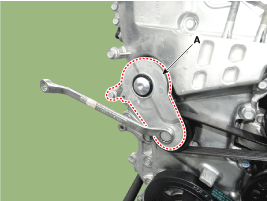
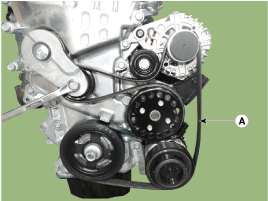
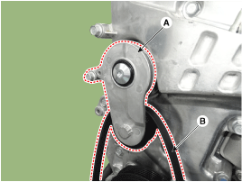
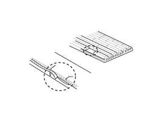
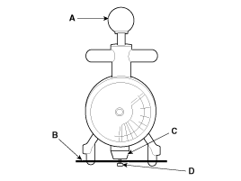
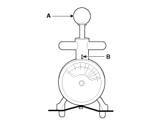
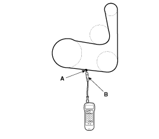
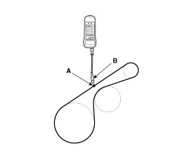

# Correia de acessórios — procedimentos

[Home](../../index.md) / [Manual de Serviço e Reparo](../sportage-482.md) / [Motorização NU](index.md) / Correia de acessórios — procedimentos

## Remoção

1. Remova o cinto de distribuição.

   (1) Usando a chave, vire o regulador de tensão do cinto de distribuição (A) no sentido horário.

    

   (2) Desconecte o cinto de distribuição (A).

    

   (3) Remova o regulador de tensão do cinto de distribuição (A) e, em seguida, remova o cinto de distribuição (B).

    

## Inspeção

1. Verifique a correia para manutenção e desgaste anormal da parte V-ribbed. Substitua se necessário.

   > **Nota**
   >
   > - Não curva, torça ou vire a correia de transmissão para dentro.
   > - Não permita que a correia de transmissão entre em contato com óleo, água e vapor.

2. Verifique visualmente a correia para desgaste excessivo, fios entrelaçados, etc.

   Se qualquer defeito for encontrado, substitua a correia de transmissão.

   > **Nota**
   >
   > - Fendas na parte ribbed da correia são consideradas aceitáveis. Se a correia tiver pedaços faltando dos ribs, ela deve ser substituída.

   

Medida e ajuste da tensão da correia

Medida da tensão da correia

Medida da tensão da correia usando um indicador de tensão mecânico ou um indicador de tensão sonora.

```
Tensão da correia
Nova correia:
637,4 ~ 735,5 N (65 ~ 75 kgf, 143,3 ~ 165,3 lbf)
Correia usada:
441,3 ~ 539,4 N (45 ~ 55 kgf, 99,2 ~ 121,3 lbf)
```

> **Nota**
   >
   > - Se o motor tiver rodado por 5 minutos ou mais, a tensão da correia deve ser ajustada como uma correia usada.
   > - Ao instalar a correia V-ribbed, todos os sulcos do pulley devem ser cobertos pelos ribs da correia.
   > - Uma correia solta causa ruído de deslizamento.
   > - Uma correia muito apertada causa danos aos rolamentos do alternador e da bomba d'água.

Usando um indicador de tensão mecânico (BT-33-73F, BTG-2)

1. Enquanto pressionando o cabo (A) do indicador, insira a correia (B) entre o pulley e o pulley (ou idler) no espaço entre o eixo (C) e a garrilha (D).

   

2. Após soltar o cabo (A), leia o valor no indicador apontado pelo indicador (B).

   

Usando um indicador de tensão sonora (U-505/507)

1. Insira os dados da correia no indicador de tensão (A).

   | Tipo de correia | Local da medição | Dados de entrada | | |
   | --- | --- | --- | --- | --- |
   | M (Massa, g/rib) | W (Largura, rib) | S (Comprimento, mm) | | |
   | Com A/C | Pulley do motor até o pulley do compressor do A/C | 14,1 | 006,0 | 187 |
   | Sem A/C | Pulley do motor até o pulley do alternador | 14,1 | 006,0 | Valor de medição real |

   > **Nota**
   >
   > - Medição de S (Comprimento): Calcule o valor médio após medir a distância 3~4 vezes.

2. Localize o microfone (B) perto do centro da extensão da correia (A) e toque a correia com o dedo 2~3 vezes. Leia o valor exibido.

   [Com A/C]

   

   [Sem A/C]

   

## Instalação

1. Instale a correia dentada.

   (1) Instale a correia dentada (B) e, em seguida, instale o regulador de tensão da correia (A).

    ```
    Torque de aperto :
    parafuso central : 29,4 ~ 41,2 N.m (3,0 ~ 4,2 kgf.m, 21,7 ~ 30,4 lb-ft)
    parafuso de fixação : 39,2 ~ 49,0 N.m (4,0 ~ 5,0 kgf.m, 28,9 ~ 36,2 lb-ft)
    ```

    

   (2) Usando a chave, vire o regulador de tensão da correia (A) no sentido anti-horário.

    

   (3) Conecte a correia dentada (A).

    

   (4) Remova a chave.
