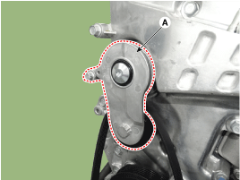

# Tensor da correia de acessórios — procedimentos

[Home](../../index.md) / [Manual de Serviço e Reparo](../sportage-482.md) / [Motorização NU](index.md) / Tensor da correia de acessórios — procedimentos

## Remoção e Instalação

1. Desconecte a correia de acessórios.

   (Consulte o Sistema de Alinhamento - "Correia de Transmissão")

2. Remova o tensador de correia de acessórios (A).

   ```
   Torque de aperto :
   parafuso central : 29,4 ~ 41,2 N.m (3,0 ~ 4,2 kgf.m, 21,7 ~ 30,4 lb-ft)
   parafuso de fixação : 39,2 ~ 49,0 N.m (4,0 ~ 5,0 kgf.m, 28,9 ~ 36,2 lb-ft)
   ```

   

3. Instale na ordem inversa à remoção.
