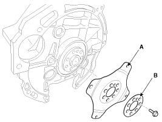

# Kia Sportage SL: Motorização NU / Drive plate Repair procedures

[Home](../../index.md) / [Kia Sportage SL Service & Repair Manual](../sportage-482.md) / [Motorização NU](index.md) / Drive plate Repair procedures

## Remoção e Instalação

1. Remova a transmissão automática.

   (Consulte o Sistema de Transmissão Automática - "Transmissão Automática")

2. Remova a placa de transmissão de potência (A) e a placa adaptadora (B).

   ```
   Torque de aperto:
   117,7 ~ 127,5 N.m (12,0 ~ 13,0 kgf.m, 86,8 ~ 94,0 lb-ft)
   ```

   

   > **Nota**
   >
   > - Não reutilize as varetas.

3. Instale na ordem inversa à remoção.
