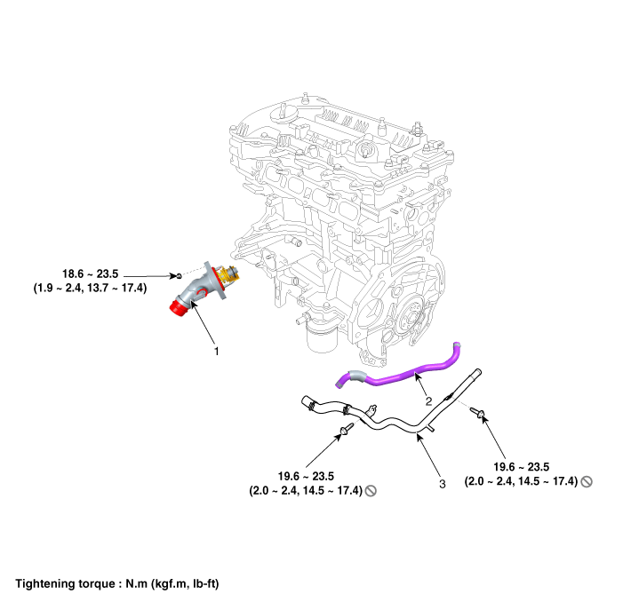

# Kia Sportage SL: Motorização NU / Electric Thermostat (ECT) Components and Components Location

[Home](../../index.md) / [Kia Sportage SL Service & Repair Manual](../sportage-482.md) / [Motorização NU](index.md) / Electric Thermostat (ECT) Components and Components Location

## Componentes

| 1. Entrada de água e Termostato | 2. Tubo de desvio |
| --- | --- |
| 3. Tubo e conjunto de mangueiras do aquecedor |
