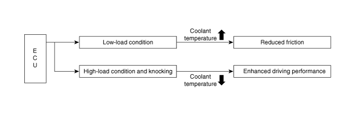
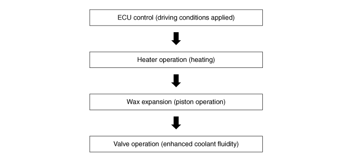
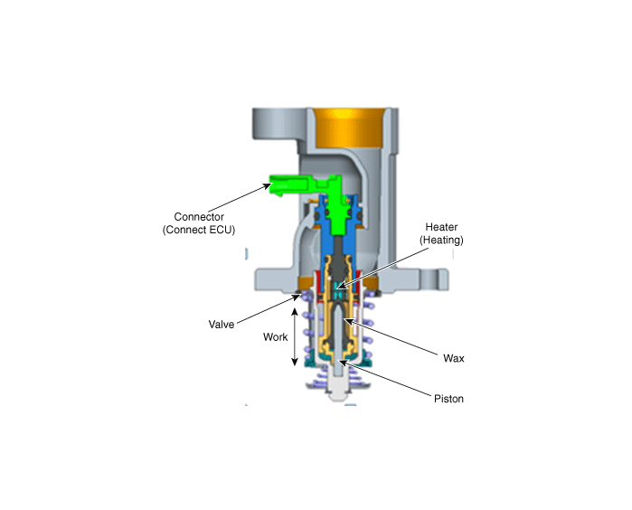

# Termostato elétrico (ECT) — descrição e operação

[Home](../../index.md) / [Manual de Serviço e Reparo](../sportage-482.md) / [Motorização NU](index.md) / Termostato elétrico (ECT) — descrição e operação

## Descrição e Operação

Termostato Elétrico (ECT)

Visão Geral

Controle ótimo da temperatura do líquido de refrigeração de acordo com as condições de direção

Princípio de Operação

Estrutura do Termostato Elétrico

