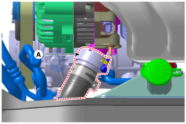
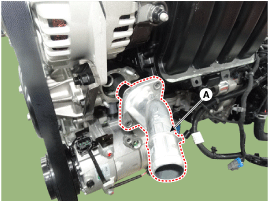
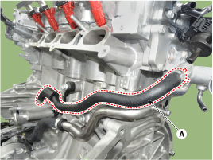
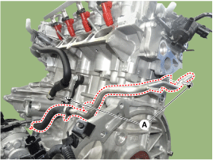
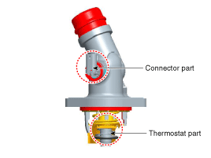

# Kia Sportage SL: Motorização NU / Electric Thermostat (ECT) Repair procedures

[Home](../../index.md) / [Kia Sportage SL Service & Repair Manual](../sportage-482.md) / [Motorização NU](index.md) / Electric Thermostat (ECT) Repair procedures

## Remoção e Instalação

> **Nota**
>
> - A desmontagem do termostato teria um efeito adverso, causando uma diminuição da eficiência do resfriamento. Não remova o termostato, mesmo que o motor apresente tendência de superaquecimento.

Termostato

1. Drenar o líquido de resfriamento do motor para que seu nível esteja abaixo do termostato.

   (Consulte o Sistema de Resfriamento - "Líquido de Resfriamento")

2. Desconectar o conectador rápido da mangueira de descarga do radiador (A).

   

   > **Nota**
   >
   > - Quando a mangueira for desligada, remova o clip do suporte (A) e, em seguida, desconecte o conectador rápido.

3. Remova a conexão de entrada de água e o termostato (A).

   ```
   Torque de aperto :
   18,6 ~ 23,5 N.m (1,9 ~ 2,4 kgf.m, 13,7 ~ 17,4 lb-ft)
   ```

   

4. Instale na ordem inversa à remoção.

   > **Nota**
   >
   > - Instale o termostato com a válvula de balanço para cima.
   > - Ao montar o termostato, coloque o termostato na caixa com a projeção do termostato correspondendo ao vaso da caixa e instale a conexão de entrada. Cuide para que o termostato não saia do vaso da caixa.
   > - Limpe a superfície em contato com o selante de borracha.

5. Preencha o líquido de resfriamento do motor.

   (Consulte o Sistema de Resfriamento - "Líquido de Resfriamento")

6. Inicie o motor e verifique por vazamentos.

7. Reverifique o nível do líquido de resfriamento.

Pipa do Aquecedor

1. Remova o manifold de admissão.

   (Consulte o Sistema de Admissão e Exaustão - "Manifold de Admissão")

2. Desconecte a mangueira de passagem (A).

   

3. Desafine os parafusos de montagem da pipa do aquecedor (A) e, em seguida, remova a pipa do aquecedor.

   ```
   Torque de aperto :
   19,6 ~ 23,5 N.m (2,0 ~ 2,4 kgf.m, 14,5 ~ 17,4 lb-ft)
   ```

   

   > **Nota**
   >
   > - Não reutilize os parafusos de selagem.

4. Instale na ordem inversa à remoção.

5. Preencha o líquido de resfriamento do motor.

   (Consulte o Sistema de Resfriamento - "Líquido de Resfriamento")

6. Inicie o motor e verifique por vazamentos.

7. Reverifique o nível do líquido de resfriamento.

## Inspeção

Termostato

1. Immerja apenas a parte do termostato em água e aqueça gradualmente a água.

   

   > **Nota**
   >
   > - Não imerga a parte do conectador.

2. Verifique a temperatura de abertura do vale.

   Se a temperatura de abertura do vale não for conforme especificado, substitua o termostato.

   ```
   Temperatura de abertura do vale:
   100 ± 2°C (212 ± 35.6°F)
   Temperatura de abertura completa: 115°C (239°F)
   ```

3. Verifique a elevação do vale.

   Se a elevação do vale não for conforme especificado, substitua o termostato.

   ```
   Elevação do vale: 8 mm (0.3 polegadas) ou mais a 115°C (239°F)
   ```
