# Conjunto motor e transmissão — procedimentos

[Home](../../index.md) / [Manual de Serviço e Reparo](../sportage-482.md) / [Motorização NU](index.md) / Conjunto motor e transmissão — procedimentos

## Remoção

> **Nota**
>
> - Use cobertores de para-choque para evitar danos às superfícies pintadas.
> - Para evitar danos, desconecte cuidadosamente os conectores de fiação segurando a parte do conectador.

| • Marque todas as fivelas e mangueiras para evitar a confusão. • Para liberar a pressão do sistema de combustível antes de remover a montagem do motor, inicie o motor sem relé do bomba de combustível e, em seguida, desligue o interruptor de ignição após o motor parar. |  |
| --- | --- |
| • | Marque todas as fivelas e mangueiras para evitar a confusão. |
| • | Para liberar a pressão do sistema de combustível antes de remover o motor, inicie o motor sem relé do bomba de combustível e, em seguida, desligue o interruptor de ignição após o motor parar. |

1. Remova o capô do motor.

   (Consulte Montagem do Motor e Transmissão - "Capô do Motor")

2. Remova o dutamento do ar e a montagem do limpador de farol.

   (Consulte Sistema de Admissão e Exaustão - "Limpador de Farol")

3. Remova a bateria.

   (Consulte Sistema Elétrico do Motor - "Bateria")

4. Remova o ECM (Unidade de Controle do Motor).

   (Consulte Sistema de Controle do Motor / Sistema de Combustível - "Unidade de Controle do Motor (ECM)")

5. Remova a prateleira da bateria.

   (Consulte Sistema Elétrico do Motor - "Bateria")

6. Remova a cobertura inferior do motor.

   (Consulte Montagem do Motor e Transmissão - "Cobertura Inferior do Motor")

7. Despeje o líquido de resfriamento do motor.

   (Consulte Sistema de Resfriamento - "Líquido de Resfriamento")

8. Desconecte o tubo de válvula de descarga do radiador (A).

   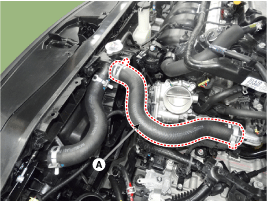

9. Desconecte a conexão rápida do tubo de descarga do radiador (A).

   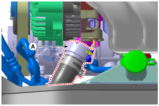

   > **Nota**
   >
   > - Quando a mangueira for desconectada, remova o clip de suporte (A) e, em seguida, desconecte a conexão rápida.

10. Recupere o refrigerante e, em seguida, remova o tubo de alta pressão e o tubo de baixa pressão.

    (Consulte Sistema de Aquecimento, Ventilação e Ar Condicionado - "Compressor")

11. Desconecte os conectores do cabo de controle e do cabo de controle do transmissor do transmissor.

    (Consulte Sistema de Transmissão Automática - "Transmissor Automático")

12. Desconecte a mangueira do boostador de freio (A).

    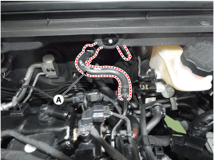

13. Desconecte as mangueiras do aquecedor (A).

    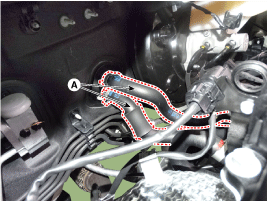

14. Desconecte o tubo de combustível (A) e o tubo de válvula de controle de purga (PCSV) (B).

    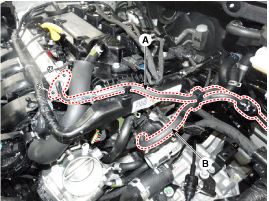

15. Desconecte o cabo de fiação do motor.

    (1) Remova a viga de fixação (A).

    (2) Desconecte o conectador do terminal negativo da bateria (B).

    (3) Desconecte o conectador do cabo frontal (C).

    (4) Desconecte o bloco PCB (D).

    (5) Desconecte o protegente de fiação (E).

     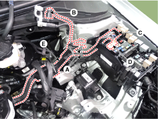

    (6) Desconecte as conexões de fiação positiva da bateria (A).

    (7) Desconecte o protegente de fiação (B).

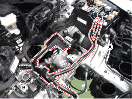

16. Remova o silencioso frontal.

   (Consulte Sistema de Admissão e Exaustão - "Silencioso")

17. Remova as varetas de montagem do articulador do volante (A).

18. Remova o suporte do braço rolante (A).

   ```
   Torque de aperto:
   Varetas (B): 49,0 ~ 63,7 N.m (5,0 ~ 6,5 kgf.m, 36,2 ~ 47,0 lb-ft)
   Parafusos (C): 107,9 ~ 127,5 N.m (11,0 ~ 13,0 kgf.m, 79,6 ~ 94,0 lb-ft)
   ```

   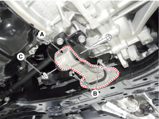

19. Remova o suporte do braço rolante (A).

   ```
   Torque de aperto:
   49,0 ~ 68,6 N.m (5,0 ~ 7,0 kgf.m, 36,2 ~ 50,6 lb-ft)
   ```

   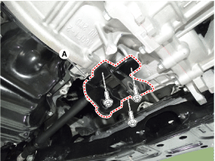

20. Remova o subquadro.

   (Consulte Sistema de Suspensão - "Subquadro")

21. Suporte o conjunto do motor e da transmissão com um jacto de solo.

22. Desconecte o cabo de terra (A).

   ```
   Torque de aperto:
   10,8 ~ 13,7 N.m (1,1 ~ 1,4 kgf.m, 8,0 ~ 10,1 lb-ft)
   ```

   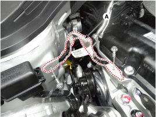

23. Remova o suporte do motor (A).

   ```
   Torque de aperto:
   Parafusos (B): 88,3 ~ 107,9 N.m (9,0 ~ 11,0 kgf.m, 65,1 ~ 79,6 lb-ft)
   Parafusos, Parafusos (C): 58,8 ~ 73,5 N.m (6,0 ~ 7,5 kgf.m, 43,4 ~ 54,2 lb-ft)
   ```

   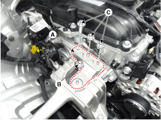

24. Desconecte a linha de terra (A).

   ```
   Torque de aperto:
   10,8 ~ 13,7 N.m (1,1 ~ 1,4 kgf.m, 8,0 ~ 10,1 lb-ft)
   ```

   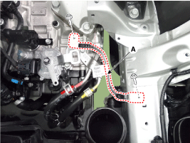

25. Remova a capa de serviço (A).

   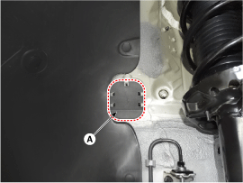

26. Remova as varetas de montagem do suporte da transmissão (A).

   ```
   Torque de aperto:
   88,3 ~ 107,9 N.m (9,0 ~ 11,0 kgf.m, 65,1 ~ 79,6 lb-ft)
   ```

   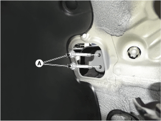

27. Remova o conjunto do motor e da transmissão levantando o veículo.

   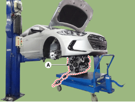

   > **Nota**
   >
   > - Antes de remover o conjunto do motor e da transmissão, certifique-se de que os mangotes e as conexões de fio estejam desconectados.
   > - Ao remover o conjunto do motor e da transmissão, tenha cuidado para não danificar qualquer parte adjacente ou componentes do corpo.

## Instalação

A instalação deve ser realizada na ordem inversa à remoção.

Realize o seguinte:

| • | Ajuste da correia do câmbio. |
| --- | --- |

| • | Ajuste da correia do acelerador. |
| --- | --- |

| • | Preencha o motor com óleo de motor. |
| --- | --- |

| • | Preencha a transmissão com fluido. |
| --- | --- |

| • | Preencha o radiador e o tanque de reservatório com líquido de refrigeração. |
| --- | --- |

| • | Coloque o controle do aquecedor na posição "QUENTE". |
| --- | --- |

| • | Descanse o sistema de refrigeração da presença de ar. |
| --- | --- |

| - | (Consulte o Sistema de Refrigeração - "Líquido de Refrigeração") |
| --- | --- |

| • | Limpe as postas da bateria e os terminais da correia com areia, monte-os e aplique uma goma para prevenir a corrosão. |
| --- | --- |

| • | Inspeção para vazamento de combustível. |
| --- | --- |

| - | Após montar a linha de combustível, ligue o interruptor da ignição (não operando o motor starter) para que a bomba de combustível funcione por aproximadamente dois segundos e a linha de combustível seja pressurizada. |
| --- | --- |

| - | Repita essa operação duas ou três vezes, depois verifique para vazamento de combustível em qualquer ponto da linha de combustível. |
| --- | --- |
