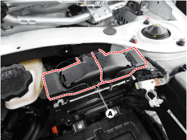
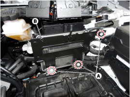
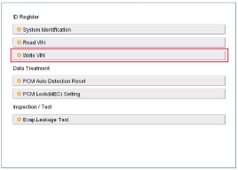
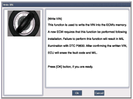

# Kia Sportage SL: Motorização NU / Engine Control Module (ECM) Repair procedures

[Home](../../index.md) / [Kia Sportage SL Service & Repair Manual](../sportage-482.md) / [Motorização NU](index.md) / Engine Control Module (ECM) Repair procedures

## Remoção

> **Cuidado**
>
> - Ao substituir o ECM, no caso de veículos equipados com sistema de imobilizador, deve-se seguir o procedimento abaixo.
> - [No caso de instalar um ECM usado]
> - 1) Realize o procedimento "Modo Neutro do ECM" com GDS.
> - (Consulte o Sistema Elétrico do Corpo - "Sistema de Imobilizador")
> - 2) Após concluir o "Modo Neutro do ECM", realize o procedimento "Aprendizado da Chave" com GDS.
> - [No caso de instalar um ECM novo]
> - Realize o procedimento "Aprendizado da Chave" com GDS.

> **Cuidado**
>
> - Ao substituir o ECM, no caso de veículos equipados com sistema de chave inteligente (start com botão), deve-se seguir o procedimento abaixo.
> - [No caso de instalar um ECM usado]
> - 1) Realize o procedimento "Modo Neutro do ECM" com GDS.
> - (Consulte o Sistema Elétrico do Corpo - "Sistema de Imobilizador")
> - 2) Após concluir o "Modo Neutro do ECM", insira a chave (ou pressione o botão start) e gire para as posições IGN ON e OFF. O ECM aprenderá automaticamente as informações da chave inteligente.
> - [No caso de instalar um ECM novo]
> - Insira a chave (ou pressione o botão start) e gire para as posições IGN ON e OFF. O ECM aprenderá automaticamente as informações da chave inteligente.

1. Desligue o interruptor de ignição e desconecte o cabo negativo (-) da bateria.

2. Remova a bateria.

   (Consulte o Sistema Elétrico do Motor - "Bateria")

3. Desconecte o conector do ECM (A).

   

4. Remova as varetas de fixação (A) e, em seguida, remova o ECM (B).

   

## Instalação

> **Cuidado**
>
> - Ao substituir o ECM, no veículo equipado com o sistema de imobilizador, deve-se seguir o procedimento abaixo.
> - [No caso de instalar um ECM usado]
> - 1) Realizar o procedimento "Modo Neutro do ECM" com o GDS.
> - (Consultar o Sistema Elétrico do Corpo - "Sistema de Imobilizador")
> - 2) Após concluir o "Modo Neutro do ECM", realizar o procedimento "Aprendizado da Chave" com o GDS.
> - [No caso de instalar um ECM novo]
> - Realizar o procedimento "Aprendizado da Chave" com o GDS.

> **Cuidado**
>
> - Ao substituir o ECM, no veículo equipado com o sistema de chave inteligente (início por botão) deve-se seguir o procedimento abaixo.
> - [No caso de instalar um ECM usado]
> - 1) Realizar o procedimento "Modo Neutro do ECM" com o GDS.
> - (Consultar o Sistema Elétrico do Corpo - "Sistema de Imobilizador")
> - 2) Após concluir o "Modo Neutro do ECM", inserir a chave (ou pressionar o botão de início) e girar para as posições de ignição ON e OFF. Então, o ECM aprenderá as informações da chave inteligente automaticamente.
> - [No caso de instalar um ECM novo]
> - Inserir a chave (ou pressionar o botão de início) e girar para as posições de ignição ON e OFF. Então, o ECM aprenderá as informações da chave inteligente automaticamente.

1. A instalação é o inverso da remoção.

   ```
   Parafuso de instalação do ECM :
   7,8 ~ 11,8 N.m (0,8 ~ 1,2 kgf.m, 5,8 ~ 8,7 lb-ft)
   Parafuso do suporte do ECM :
   9,8 ~ 11,8 N.m (1,0 ~ 1,2 kgf.m, 7,2 ~ 8,7 lb-ft)
   ```

## Procedimento de Verificação de Problemas no ECM

1. TESTAR CIRCUITO DE CHÃO DO ECM: Medir a resistência entre o ECM e o chassi de chão usando o lado traseiro do conector do harness do ECM como ponto de verificação do ECM. Se o problema for encontrado, realize a reparação.

   ```
   Especificação : Menor que 1?
   ```

2. TESTAR CONECTOR DO ECM: Desconecte o conector do ECM e verifique visualmente os terminais de chão do ECM e do harness para pinos torcidos ou pressão de contato pobre. Se o problema for encontrado, realize a reparação.

3. Se o problema não for encontrado nos passos 1 e 2, o ECM pode estar danificado. Neste caso, certifique-se de que não houve DTCs antes de trocar o ECM por um novo, e então verifique o veículo novamente. Se DTCs foram encontrados, examine isso primeiro antes de trocar o ECM.

4. RE-TESTAR O ECM ORIGINAL: Instale o ECM original (pode estar quebrado) em um veículo conhecido como bom e verifique o veículo. Se o problema ocorrer novamente, substitua o ECM original por um novo. Se o problema não ocorrer, este é um problema intermitente (Consulte o "Procedimento de Verificação de Problemas Intermitentes" no "Procedimento de Verificação Básica").

Procedimento de Programação do VIN

VIN (Número de Identificação do Veículo) é um número que contém as informações do veículo (Fabricante, Tipo de Veículo, Série do Veículo, Tipo de Corpo, Tipo de Motor, Tipo de Transmissão, Ano do Modelo, Local de Fabricação, etc.). Para mais informações, consulte o grupo "GI" neste MANUAL DE SERVIÇO. Ao substituir um ECM, o VIN deve ser programado no ECM. Se não houver VIN na memória do ECM, o código de falha (DTC P0630) será estabelecido.

> **Cuidado**
>
> - O VIN programado não pode ser alterado. Ao escrever o VIN, confirme-o cuidadosamente.

1. Selecione a função "Programação do VIN" no "Gerenciamento de Software do Veículo".

2. Selecione "Escrever VIN" no "Registro de ID".

   

3. Insira o VIN.

   > **Aviso**
   >
   > - Antes de inserir o VIN, confirme-o novamente porque o VIN programado não pode ser alterado.

   

4. Desligue a chave do ignição, depois ligue novamente.
