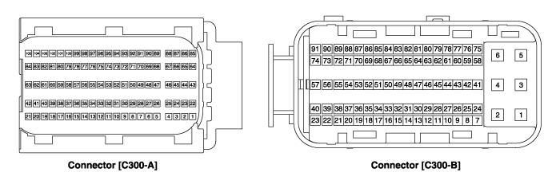

# Kia Sportage SL: Motorização NU / Engine Control Module (ECM) Schematic Diagrams

[Home](../../index.md) / [Kia Sportage SL Service & Repair Manual](../sportage-482.md) / [Motorização NU](index.md) / Engine Control Module (ECM) Schematic Diagrams

## Terminal e Sinal de Entrada/Saída do ECM

Conector do Cinto

Função do Terminal do ECM

Conector [C300-A]

| Número da Pinagem | Descrição | Conectado a |
| --- | --- | --- |
| 1 | - |  |
| 2 | Saída de controle do motor ETC [+] | Motor ETC |
| 3 | - |  |
| 4 | Saída de controle do motor [-] | Atuador de Movimento de Carga Variável (VCMA) |
| 5 | - |  |
| 6 | - |  |
| 7 | - |  |
| 8 | - |  |
| 9 | - |  |
| 10 | Sinal de entrada do interruptor de embreagem [M/T] | Interruptor de embreagem |
| 11 | - |  |
| 12 | - |  |
| 13 | - |  |
| 14 | - |  |
| 15 | Sinal de terra do sensor | Sensor de Temperatura do Coolante do Motor (ECTS) |
| 16 | Sinal de entrada do sensor de temperatura do coolante do motor (ECTS) | Sensor de Temperatura do Coolante do Motor (ECTS) |
| 17 | Sinal de entrada do sensor de posição do acelerador (TPS) 2 | Sensor de Posição do Acelerador (TPS) 2 |
| 18 | - |  |
| 19 | - |  |
| 20 | - |  |
| 21 | Sinal de alimentação elétrica (+5V) | Sensor de Pressão Absoluta do Manifold (MAPS) |
| Sensor de Posição do Camaroto (CMPS) [Banco 1/Intalação] |  |  |
| 22 | - |  |
| 23 | Saída de controle do motor [-] | Motor ETC |
| 24 | - |  |
| 25 | Saída de controle do motor [+] | Atuador de Movimento de Carga Variável (VCMA) |
| 26 | - |  |
| 27 | - |  |
| 28 | - |  |
| 29 | - |  |
| 30 | - |  |
| 31 | Sinal de entrada de carga elétrica | Alternador |
| 32 | - |  |
| 33 | - |  |
| 34 | - |  |
| 35 | - |  |
| 36 | - |  |
| 37 | Sinal de terra do sensor | Sensor de Posição do Acelerador (TPS) 1,2 |
| 38 | Sinal de entrada do sensor de posição do acelerador (TPS) 1 | Sensor de Posição do Acelerador (TPS) 1 |
| 39 | - |  |
| 40 | Saída de controle do alternador PWM | Alternador |
| 41 | - |  |
| 42 | Sinal de alimentação elétrica (+5V) | Sensor de Posição do Acelerador (TPS) 1,2 |
| 43 | - |  |
| 44 | - |  |
| 45 | - |  |
| 46 | - |  |
| 47 | - |  |
| 48 | - |  |
| 49 | - |  |
| 50 | - |  |
| 51 | - |  |
| 52 | - |  |
| 53 | - |  |
| 54 | Sinal de terra do feedback do VCMA | Atuador de Movimento de Carga Variável (VCMA) |
| 55 | - |  |
| 56 | Sinal de terra do sensor | Sensor de Posição do Camaroto (CMPS) [Banco 1/Exalação] |
| 57 | - |  |
| 58 | - |  |
| 59 | - |  |
| 60 | - |  |
| 61 | Sinal de terra do sensor | Sensor de Pressão Absoluta do Manifold (MAPS) |
| 62 | Sinal de entrada do sensor de pressão absoluta do manifold (MAPS) | Sensor de Pressão Absoluta do Manifold (MAPS) |
| 63 | Sinal de alimentação elétrica (+5V) | Sensor de Posição do Camaroto (CMPS) [Banco 1/Exalação] |
| Atuador de Movimento de Carga Variável (VCMA) |  |  |
| 65 | - |  |
| 66 | - |  |
| 67 | - |  |
| 68 | - |  |
| 69 | - |  |
| 70 | - |  |
| 71 | - |  |
| 72 | - |  |
| 73 | - |  |
| 74 | Sinal de terra do sensor | Sensor de Posição do Camaroto (CKPS) |
| 75 | - |  |
| 76 | Sinal de entrada do feedback do VCMA | Atuador de Movimento de Carga Variável (VCMA) |
| 77 | Sinal de entrada do sensor de Posição do Camaroto (CMPS) [Banco 1/Exalação] | Sensor de Posição do Camaroto (CMPS) [Banco 1/Exalação] |
| 78 | Sinal de terra do sensor | Sensor de Posição do Camaroto (CMPS) [Banco 1/Intalação] |
| 79 | - |  |
| 80 | - |  |
| 81 | - |  |
| 82 | - |  |
| 83 | VG (Virtual Ground) | Sensor de Oxigênio Quente [Banco 1/Sensor 1] |
| 84 | VRC (Ajuste de Corrente) | Sensor de Oxigênio Quente [Banco 1/Sensor 1] |
| 85 | - |  |

| 86 | - |  |
| 87 | - |  |
| 88 | - |  |
| 89 | - |  |
| 90 | - |  |
| 91 | - |  |
| 92 | - |  |
| 93 | - |  |
| 94 | - |  |
| 95 | Entrada de sinal do Sensor de Posição do Crankshaft (CKPS) | Sensor de Posição do Crankshaft (CKPS) |
| 96 | - |  |
| 97 | - |  |
| 98 | Entrada de sinal do Sensor de Posição do Camshaft (CMPS) [Bank 1/Intake] | Sensor de Posição do Camshaft (CMPS) [Bank 1/Intake] |
| 99 | Sinal de terra do sensor | Sensor de Impacto (KS) |
| 100 | Entrada de sinal do Sensor de Impacto (KS) | Sensor de Impacto (KS) |
| 101 | Entrada de sinal do Sensor de Temperatura do Ar Intalado (IATS) | Sensor de Temperatura do Ar Intalado (IATS) |
| 102 | - |  |
| 103 | - |  |
| 104 | VN (NERNST Cell Voltage) | Sensor de Oxigênio Quente (HO2S) [Bank 1/Sensor 1] |
| 105 | VIP (Corrente do Bomba) | Sensor de Oxigênio Quente [Bank 1/Sensor 1] |

Conector [C300-B]

| Número do Pin | Descrição | Conectado a |
| --- | --- | --- |
| 1 | Terra de alimentação | Chassi de terra |
| 2 | Terra de alimentação | Chassi de terra |
| 3 | Poder da bateria (B+) | Relé principal |
| 4 | Terra de alimentação | Chassi de terra |
| 5 | Poder da bateria (B+) | Relé principal |
| 6 | Poder da bateria (B+) | Relé principal |
| 7 | - |  |
| 8 | FLEX-RAY (Alto) | Outro módulo de controle, Conector de Linha de Dados (DLC) |
| 9 | - |  |
| 10 | Entrada de sinal do Sensor de Posição do Acelerador (APS) 2 | Sensor de Posição do Acelerador (APS) 2 |
| 11 | Entrada de sinal do Transdutor de Pressão do Sistema de Ar Condicionado (APT) | Transdutor de Pressão do Sistema de Ar Condicionado (APT) |
| 12 | - |  |
| 13 | - |  |
| 14 | Sinal de alimentação (+5V) | Transdutor de Pressão do Sistema de Ar Condicionado (APT) |
| Sensor de Pressão do Tanque de Combustível (FTPS) |  |  |
| 15 | - |  |
| 16 | Sinal de alimentação (+5V) | Sensor de Posição do Acelerador (APS) 2 |
| 17 | Sinal de alimentação (+5V) | Sensor de Posição do Acelerador (APS) 1 |
| 18 | Saída de controle do Relé principal | Relé principal |
| 19 | Saída de controle do Relé do Bomba de Combustível | Relé do Bomba de Combustível |
| 20 | - |  |
| 21 | - |  |
| 22 | Saída de controle do injetor (Cilindro #2) | Injetor (Cilindro #2) |
| 23 | Saída de controle do injetor (Cilindro #3) | Injetor (Cilindro #3) |
| 24 | - |  |
| 25 | FLEX-RAY (Baixo) | Outro módulo de controle, Conector de Linha de Dados (DLC) |
| 26 | Entrada de sinal elétrico [Interruptor Máximo do Ventilador] | Módulo de controle do aquecedor e do sistema de ar condicionado |
| 27 | Entrada de sinal do Sensor de Posição do Acelerador (APS) 1 | Sensor de Posição do Acelerador (APS) 1 |
| 28 | Terra de sensor | Sensor de Oxigênio Quente (HO2S) [Bank 1/Sensor 2] |
| 29 | Entrada de sinal do Sensor de Oxigênio Quente (HO2S) [Bank 1/Sensor 2] | Sensor de Oxigênio Quente (HO2S) [Bank 1/Sensor 2] |
| 30 | Entrada de sinal do Sensor de Pressão do Tanque de Combustível | Sensor de Pressão do Tanque de Combustível (FTPS) |
| 31 | - |  |
| 32 | - |  |
| 33 | - |  |
| 34 | Saída de controle do relé do motor de partida | Relé do motor de partida |
| 35 | Saída de controle do Valvula de Controle de Óleo CVVT (OCV) [Bank 1/Exhaust] | Valvula de Controle de Óleo CVVT (OCV) [Bank 1/Exhaust] |
| 36 | Saída de controle do Valvula de Controle de Óleo CVVT (OCV) [Bank 1/Intake] #1 | Valvula de Controle de Óleo CVVT (OCV) [Bank 1/Intake] #1 |
| 37 | - |  |
| 38 | Saída de controle do relé do sistema de ar condicionado | Relé do sistema de ar condicionado |
| 39 | Saída de controle do injetor (Cilindro #4) | Injetor (Cilindro #3) |

| 40 | Saída de Controle do Bobinado de Ignição (Cilindro #2) | Bobinado de Ignição (Cilindro #2) [Tipo Não-Imobilizador] |
| Saída de Controle do Bobinado de Ignição (Cilindro #3) | Bobinado de Ignição (Cilindro #3) [Tipo Imobilizador] |  |
| 41 | Poder da Bateria (B+) | Interruptor da Ignição |
| 42 | - |  |
| 43 | - |  |
| 44 | - |  |
| 45 | Terceiro Ponto de Terra do Sensor | Sensor de Posição do Acelerador (APS) 1 |
