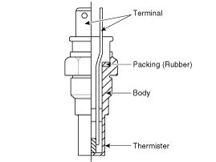

# Sensor ECTS (temperatura do líquido de arrefecimento) — descrição e operação

[Home](../../index.md) / [Manual de Serviço e Reparo](../sportage-482.md) / [Motorização NU](index.md) / Sensor ECTS (temperatura do líquido de arrefecimento) — descrição e operação

## Descrição

Sensor de Temperatura do Coolante do Motor (ECTS) está localizado na passagem de coolante do cabeçote do cilindro para detectar a temperatura do coolante do motor. O ECTS usa um termistor cuja resistência muda com a temperatura.

A resistência elétrica do ECTS diminui à medida que a temperatura aumenta, e aumenta à medida que a temperatura diminui. A referência +5V é fornecida ao ECTS através de um resistor no ECM. Isso significa que o resistor no ECM e o termistor no ECTS estão conectados em série. Quando o valor de resistência do termistor no ECTS muda de acordo com a temperatura do coolante do motor, a tensão de saída também muda.

Durante a operação do motor frio, o ECM aumenta a duração da injeção de combustível e controla o ajuste da ignição usando as informações da temperatura do coolante do motor para evitar o estatelamento do motor e melhorar a dirigibilidade.

