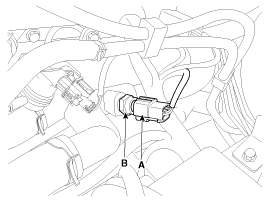

# Kia Sportage SL: Motorização NU / Engine Coolant Temperature Sensor (ECTS) Repair procedures

[Home](../../index.md) / [Kia Sportage SL Service & Repair Manual](../sportage-482.md) / [Motorização NU](index.md) / Engine Coolant Temperature Sensor (ECTS) Repair procedures

## Inspeção

1. Desligue a chave do motor.

2. Desconecte o conector do ECTS.

3. Remova o ECTS.

4. Imerso o termistor do sensor no coolante do motor, mede a resistência entre os terminais 1 e 3 do ECTS.

5. Verifique que a resistência esteja dentro da especificação.

   ```
   Especificação : Consulte "Especificação"
   ```

## Remoção

1. Desligue a chave do motor e desconecte o cabo negativo (-) da bateria.

2. Desconecte o conector do sensor de temperatura do coolante do motor (A).

3. Remova o sensor (B).

   

   > **Cuidado**
   >
   > - Note que o coolante do motor pode fluir do conjunto de controle da temperatura do líquido quando o sensor for removido.

4. Suplemente o coolante do motor.

   (Consulte Sistema Mecânico do Motor - "Líquido")

## Instalação

> **Cuidado**
>
> - Instale o componente com as torques especificadas.
> - Note que danos internos podem ocorrer se o componente for solto.

> **Cuidado**
>
> - Aplicar o coolante do motor no anel de vedação.

> **Cuidado**
>
> - Insira o sensor na fenda de instalação e preste atenção para não danificar.

1. A instalação é o inverso da remoção.

   ```
   Instalação do sensor de temperatura do coolante do motor :
   29,4 ~ 39,2 N.m (3,0 ~ 4,0 kgf.m, 21,7 ~ 28,9 lb-ft)
   ```
