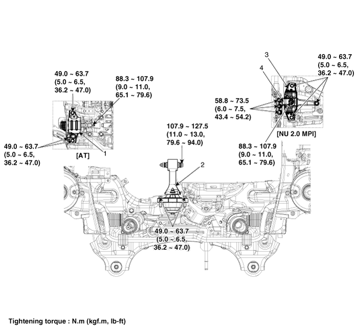

# Coxins do motor — componentes e localização

[Home](../../index.md) / [Manual de Serviço e Reparo](../sportage-482.md) / [Motorização NU](index.md) / Coxins do motor — componentes e localização

## Componentes

| 1. Mola de montagem do transaxle 2. Mola do rolamento transversal | 3. Mola de montagem do motor 4. Mola de suporte de montagem do motor |
| --- | --- |
