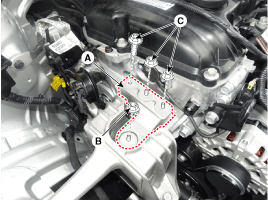
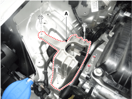
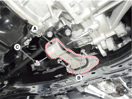
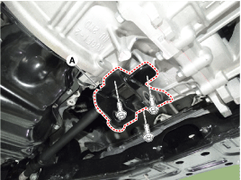
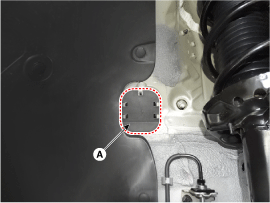
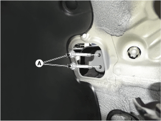
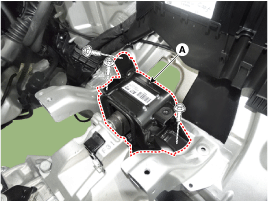

# Coxins do motor — procedimentos

[Home](../../index.md) / [Manual de Serviço e Reparo](../sportage-482.md) / [Motorização NU](index.md) / Coxins do motor — procedimentos

## Remoção e Instalação

Apoio de Montagem do Motor

1. Remova o cobertura inferior do motor.

   (Consulte Montagem do Motor e Transaxle - "Cobertura Inferior do Motor")

2. Posicione o guincho sob o bordo da panalva inferior para suportar o motor.

   > **Nota**
   >
   > - Coloque o bloco de borracha entre o guincho e a panalva para evitar danos à panalva.

3. Remova o apoio de montagem do motor (A).

   ```
   Torque de aperto:
   Parafuso (B): 88,3 ~ 107,9 N.m (9,0 ~ 11,0 kgf.m, 65,1 ~ 79,6 lb-ft)
   Parafuso, Parafusos (C): 58,8 ~ 73,5 N.m (6,0 ~ 7,5 kgf.m, 43,4 ~ 54,2 lb-ft)
   ```

   

4. Remova o apoio de montagem do motor (A).

   ```
   Torque de aperto:
   49,0 ~ 63,7 N.m (5,0 ~ 6,5 kgf.m, 36,2 ~ 47,0 lb-ft)
   ```

   

5. Instale na ordem inversa da remoção.

Apoio de Montagem do Rolamento

1. Remova o cobertura inferior do motor.

   (Consulte Montagem do Motor e Transaxle - "Cobertura Inferior do Motor")

2. Remova o apoio de montagem do rolamento (A).

   ```
   Torque de aperto
   Parafusos (B):
   49,0 ~ 63,7 N.m (5,0 ~ 6,5 kgf.m, 36,2 ~ 47,0 lb-ft)
   Parafuso (C):
   107,9 ~ 127,5 N.m (11,0 ~ 13,0 kgf.m, 79,6 ~ 94,0 lb-ft)
   ```

   

3. Remova o apoio de montagem do rolamento (A).

   ```
   Torque de aperto :
   49,0 ~ 68,6 N.m ( 5,0 ~ 7,0 kgf.m, 36,2 ~ 50,6 lb-ft)
   ```

   

4. Instale na ordem inversa da remoção.

Apoio de Montagem do Transaxle

1. Remova a assemblagem do difusor e do limpador de ar.

   (Consulte Sistema de Admissão e Emissão - "Limpador de Ar")

2. Remova a bateria.

   (Consulte Sistema Elétrico do Motor - "Bateria")

3. Remova o ECM (Unidade de Controle do Motor).

   (Consulte Sistema de Controle do Motor / Sistema de Combustível - "Unidade de Controle do Motor (ECM)")

4. Remova a prateleira da bateria.

   (Consulte Sistema Elétrico do Motor - "Bateria")

5. Remova a cobertura inferior do motor.

   (Consulte Montagem do Motor e Transaxle - "Cobertura Inferior do Motor")

6. Posicione o guincho sob o transaxle para suportá-lo.

7. Remova a tampa de serviço (A).

   

8. Remova os parafusos de montagem do apoio de montagem do transaxle (A).

   ```
   Torque de aperto :
   88,3 ~ 107,9 N.m (9,0 ~ 11,0 kgf.m, 65,1 ~ 79,6 lb-ft)
   ```

   

9. Remova o apoio de montagem do transaxle (A).

   ```
   Torque de aperto :
   49,0 ~ 63,7 N.m (5,0 ~ 6,5 kgf.m, 36,2 ~ 47,0 lb-ft)
   ```

   

10. Instale na ordem inversa da remoção.
