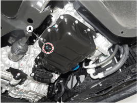
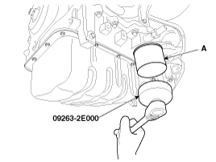
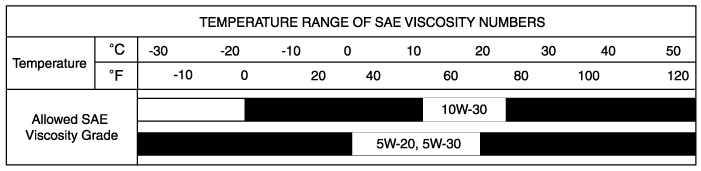

# Óleo do motor — procedimentos

[Home](../../index.md) / [Manual de Serviço e Reparo](../sportage-482.md) / [Motorização NU](index.md) / Óleo do motor — procedimentos

## Troca de Óleo e Filtro

> **Cuidado**
>
> - O contato prolongado e repetido com óleo mineral pode remover os ácidos naturais da pele, causando secamento, irritação e dermatite. Além disso, o óleo de motor usado contém contaminantes potencialmente prejudiciais que podem causar câncer de pele.
> - Exercite cuidado para minimizar o contato da pele com óleo usado. Use roupas protetivas e luvas. Lave a pele com sabão e água ou use limpador de mãos sem água para remover qualquer óleo de motor usado. Não use gasolina, dissolventes ou solventes.
> - Para preservar o meio ambiente, o óleo e o filtro de óleo usado devem ser descartados apenas em locais de descarte apropriados.

1. Estacione o carro em terreno nivelado.

2. Drenar o óleo do motor.

   (1) Remova a tampa do enchimento de óleo.

   (2) Após levantar o carro, remova a tampa do dreno (A) e drenagem de óleo em um recipiente.

    

3. Substitua o filtro de óleo (A).

   (1) Usando o SST (09263-2E000), remova o filtro de óleo.

   (2) Verifique e limpe a superfície de instalação do filtro de óleo.

   (3) Verifique se o número de parte do novo filtro de óleo é o mesmo que o antigo.

   (4) Aplicar óleo de motor limpo ao anel do novo filtro de óleo.

   (5) Encaixe o filtro de óleo suavemente e aperte até que o anel entre em contato com a base.

   (6) Aperte com a torção abaixo.

    ```
    Torção de aperto :
    11.8 ~ 15.7 N.m (1.2 ~ 1.6 kgf.m, 8.7 ~ 11.6 lb-ft)
    ```

    

4. Instale a tampa do dreno com um novo anel.

    ```
    Torção de aperto :
    34.3 ~ 44.1 N.m (3.5 ~ 4.5 kgf.m, 25.3 ~ 32.5 lb-ft)
    ```

5. Preencha com novo óleo do motor, após remover o indicador do nível de óleo do motor.

    ```
    Capacidade
    Total:
    4.5 L (1.19 U.S.gal., 4.76 U.S.qt., 3.96 lmp.qt.)
    Pan de óleo: 3.7 L (0.98 U.S.gal., 3.91 U.S.qt., 3.26 lmp.qt.)
    Drenagem e refil incluindo filtro de óleo:
    4.0 L (1.06 U.S.gal., 4.23 U.S.qt., 3.52 lmp.qt.)
    ```

6. Instale a tampa do enchimento de óleo.

7. Inicie o motor e verifique por vazamentos de óleo e verifique o indicador de nível de óleo ou a luz para indicar a pressão do óleo.

8. Verifique novamente o nível de óleo do motor.

## Inspeção

1. Verifique a qualidade do óleo do motor.

   Verifique a deterioração do óleo, entrada d'água e descoloração ou afinamento. Se a qualidade for visivelmente ruim, troque o óleo.

2. Verifique o nível do óleo do motor.

   Após aquecimento do motor, pare o motor e aguarde 5 minutos. Em seguida, verifique o nível do óleo. O nível do óleo deve estar entre as marcas "L" e "F" no palito do nível. Se o nível estiver baixo, verifique se há vazamento e adicione óleo até a marca "F".

   > **Nota**
   >
   > - Não preencha com óleo do motor acima da marca "F".

Seleção do Óleo do Motor

Especificações:

5W-20 / API SM & ILSAC GF-4 (ou superior) / ACEA A5 (ou superior)

| • Óleo de motor API SL, ILSAC GF-3, ACEA A3 pode ser usado se o óleo de motor recomendado não estiver disponível. |  |
| --- | --- |
| • Óleo de motor API SL, ILSAC GF-3, ACEA A3 pode ser usado se o óleo de motor recomendado não estiver disponível. |

Permissão para Viscosidade SAE



> **Nota**
>
> - Para melhor desempenho e proteção máxima em todas as operações, selecione apenas os lubrificantes que:
> - Satisfazam a exigência da classificação ILSAC (API) ou ACEA.
> - Tenham o número de grade SAE apropriado para a faixa de temperatura ambiente esperada.
> - Lubrificantes que não tenham tanto um número de grade SAE e
classificação de serviço ILSAC (API) ou ACEA na embalagem não devem
ser utilizados.
