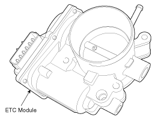
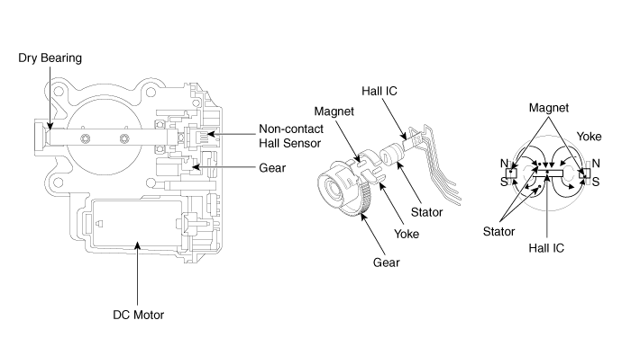
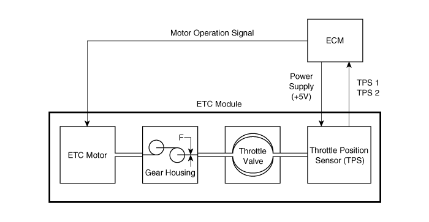

# ETC (controle eletrônico da borboleta) — descrição e operação

[Home](../../index.md) / [Manual de Serviço do Kia Sportage NU](index.md) / [Controle do Motor/Sistema de Combustível](nu-engine_control_fuel_system-3018.md) / [Sistema de Controle do Motor](nu-engine_control_system-3023.md) / ETC (controle eletrônico da borboleta) — descrição e operação

## Descrição

O Sistema de Controlador Eletrônico do Acelerador (ETC) consiste em um corpo de acelerador com motor de controle integrado e sensor de posição do acelerador (TPS, em inglês). Em vez de uma tradicional corda de acelerador, é utilizado um Sensor de Posição do Acelerador (APS, em inglês) para receber a entrada do motorista. O ECM utiliza o sinal do APS para calcular o ângulo de acelerador alvo; a posição do acelerador é então ajustada através do controle do ECM sobre o motor ETC. O sinal do TPS é utilizado para fornecer feedback sobre a posição do acelerador ao ECM. Usando o ETC, é possível um controle preciso sobre a posição do acelerador; a necessidade de módulos/cordas de controle de cruzeiro externos é eliminada.

## Diagrama Esquemático

