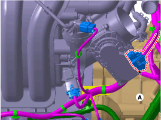
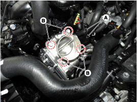

# ETC (controle eletrônico da borboleta) — procedimentos

[Home](../../index.md) / [Manual de Serviço e Reparo](../sportage-482.md) / [Motorização NU](index.md) / ETC (controle eletrônico da borboleta) — procedimentos

## Inspeção

Sensor de Posição da Borboleta (TPS)

1. Conecte o GDS na Conector de Interface de Dados (CID).

2. Inicie o motor e medir a tensão de saída do TPS 1 e 2 no C.T. e W.O.T.

   | Ângulo da Borboleta | Tensão de Saída (V) | |
   | --- | --- | --- |
   | TPS 1 | TPS 2 | |
   | C.T | 0,5 | 4,5 |
   | W.O.T | 4,41 | 0,59 |

Motor ETC

1. Desligue o interruptor de ignição.

2. Desconecte o conector do módulo ETC.

3. Medir a resistência entre os terminais 1 e 2 do módulo ETC.

4. Verifique que a resistência esteja dentro da especificação.

   ```
   Especificação : Consulte "Especificação"
   ```

## Remoção

1. Desligue o interruptor de ignição e desconecte o cabo negativo (-) da bateria.

2. Remova o resonador e a mangueira de admissão de ar.

   (Consulte Sistema Mecânico do Motor - "Filtro de Ar")

3. Desconecte o conector do módulo ETC (A).

   

4. Desconecte as mangueiras de arrefecimento (A).

5. Remova as varetas de fixação (B) e, em seguida, remova o módulo ETC do motor.

   

## Instalação

> **Cuidado**
>
> - Instale o componente com as torques especificados.
> - Tenha em mente que danos internos podem ocorrer quando o componente é solto. Neste caso, use após a inspeção.

1. A instalação é o inverso da remoção.

   ```
   Chave de Aceleração Eletrônica: Válvula de Corpo de Chave de Aceleração
   7,8 ~ 11,8 N.m (0,8 ~ 1,2 kgf.m, 5,8 ~ 8,7 lb-ft)
   ```
