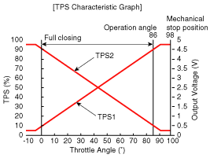

# ETC (controle eletrônico da borboleta) — especificações

[Home](../../index.md) / [Manual de Serviço e Reparo](../sportage-482.md) / [Motorização NU](index.md) / ETC (controle eletrônico da borboleta) — especificações

## Especificações

| Ângulo da Borboleta (°) | Tensão de Saída (V) [Vref = 5,0V] |  |
| --- | --- | --- |
| TPS1 | TPS2 |  |
| 0 | 0,5 | 4,5 |
| 10 | 0,96 | 4,05 |
| 20 | 1,41 | 3,59 |
| 30 | 1,87 | 3,14 |
| 40 | 2,32 | 2,68 |
| 50 | 2,78 | 2,23 |
| 60 | 3,23 | 1,77 |
| 70 | 3,69 | 1,32 |
| 80 | 4,14 | 0,86 |
| 90 | 4,6 | 0,41 |
| 98 | 4,65 | 0,35 |
| C.T (0) | 0,5 | 4,5 |
| W.O.T (86) | 4,41 | 0,59 |

### Motor ETC

| Item | Especificação |
| --- | --- |
| Resistência do Bobinado (?) | 0,3 ~ 100 [20°C(68°F)] |
