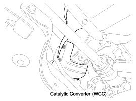
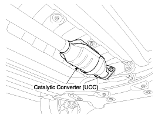
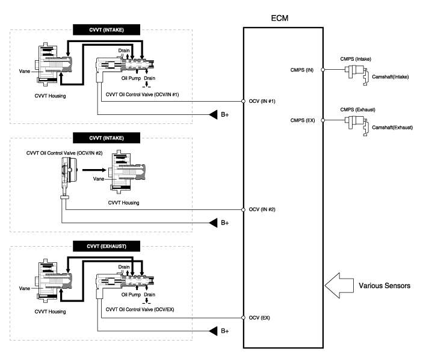
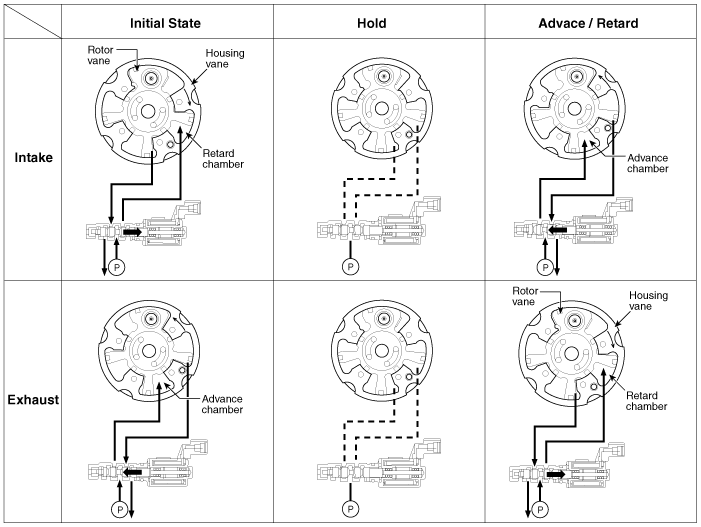
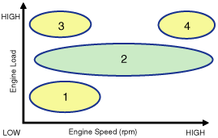

# Controle de emissões de escape

[Home](../../index.md) / [Manual de Serviço e Reparo](../sportage-482.md) / [Motorização NU](index.md) / Controle de emissões de escape

## Descrição e Operação

## Descrição

As emissões de esgoto (CO, HC, NOx) são controladas por uma combinação de modificações no motor e da adição de componentes de controle especiais.

Modificações no câmara de combustão, tubo de admissão, eixo de válvulas e sistema de ignição formam o sistema de controle básico.

Estes itens foram integrados em um sistema altamente eficaz que controla as emissões de esgoto mantendo uma boa dirigibilidade e economia de combustível.

Sistema de Controle da Mistura Ar/Combustível [Sistema de Injeção Multiponto a Combustível (MFI)]

O sistema MFI usa sinais do sensor de oxigênio aquecido para ativar e controlar o injetor instalado no tubo de admissão de cada cilindro, regulando precisamente a razão de mistura ar/combustível e reduzindo as emissões.

Isso permite que o motor produza gás de esgoto com a composição correta para permitir o uso do catalisador a três vias. O catalisador a três vias é projetado para converter os três poluentes [hidrocarbonetos (HC), monóxido de carbono (CO), e oxides de nitrogênio (NOx)] em substâncias inofensivas. O sistema MFI tem dois modos de operação.

1. Modo Aberto: A razão de mistura ar/combustível é controlada por informações pré-programadas no ECM.

2. Modo Fechado: A razão de mistura ar/combustível é constantemente ajustada pelo ECM com base em informações fornecidas pelo sensor de oxigênio.

## Descrição e Operação do Catalisador

## Descrição

O catalisador do motor a gasolina é um catalisador a três vias. Ele oxida o monóxido de carbono e os hidrocarbonetos (HC), e separa o oxigênio das oxides de nitrogênio (NOx).

## Descrição e Operação do Sistema CVVT (Timing Variável Contínuo de Válvulas)

## Descrição

Sistema de Variação Contínua da Abertura dos Valvulários (CVVT) ajusta o tempo de abertura e fechamento dos válvulos de admissão e exaustão de acordo com o sinal de controle do ECM, que é calculado com base na velocidade do motor e na carga.

Controlando o CVVT, ocorre uma sobrecruzamento ou subcruzamento dos valvulários, o que melhora a economia de combustível e reduz as emissões de gases de escape (NOx, HC) e melhora o desempenho do motor através da redução da perda de bombagem, do efeito de EGR interno, da estabilidade da combustão, da eficiência volumétrica e do trabalho de expansão.

Este sistema consiste no Valvulário de Controle de Óleo de CVVT (OCV), que fornece óleo do motor ao faseador do cárter ou despeja o óleo do motor do faseador do cárter de acordo com o sinal de controle PWM (Modulação de Pulso) do ECM, e no Faseador do Cárter, que varia o faseamento do cárter usando a força hidráulica do óleo do motor.

O óleo do motor que sai do valvulário de controle de óleo de CVVT varia o faseamento do cárter no sentido (Avanço da Admissão/Retardo da Exaustão) ou no sentido oposto (Retardo da Admissão/Avanço da Exaustão) da rotação do motor, rotacionando o rotor conectado ao eixo do cárter dentro do faseador do cárter.

## Princípio de Operação

O CVVT tem o mecanismo de rotacionar o vano do rotor com a força hidráulica gerada pelo óleo do motor suprido ao câmara de avanço ou retardamento de acordo com o controle do valvulário de controle de óleo de CVVT.

| • Um solenoide separado está instalado na cobertura da corrente no lado de admissão para fechar e liberar um pincolet separado. |  |
| --- | --- |
| • | Um solenoide separado está instalado na cobertura da corrente no lado de admissão para fechar e liberar um pincolet separado. |

## [Modo do Sistema CVVT]

| (1) Baixa Velocidade / Baixa Carga | (2) Carga Parcial |
| --- | --- |
| (3) Baixa Velocidade / Alta Carga | (4) Alta Velocidade / Alta Carga |

| Condição de Direção | Válvula de Exaustão | Válvula de Admissão |  |  |
| --- | --- | --- | --- | --- |
| Tempo de Abertura | Efeito | Tempo de Abertura | Efeito |  |
| (1) Baixa Velocidade / Baixa Carga | Avanço Completo | * Melhora da Estabilidade da Combustão * Sobrecruzamento da Válvula | Retardo Completo | * Melhora da Estabilidade da Combustão * Sobrecruzamento da Válvula |
| (2) Carga Parcial | Retardo | * Redução de HC * | Retardo | * Atrasa o fechamento da válvula de admissão para reduzir a perda de bombagem * Aumenta o trabalho de expansão |
| (3) Baixa Velocidade / Alta Carga | Retardo | * Aumento do Trabalho de Expansão * | Avanço | * Prevenção do retorno de admissão (Melhora da Eficiência Volumétrica) |
| (4) Alta Velocidade / Alta Carga | Avanço | * Redução da Perda de Bombagem * | Retardo | * Melhora da Eficiência Volumétrica * |
