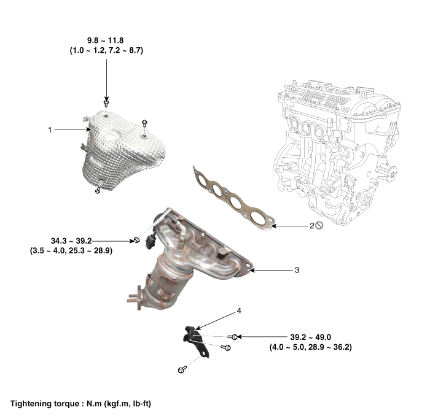

# Coletor de escape — componentes e localização

[Home](../../index.md) / [Manual de Serviço e Reparo](../sportage-482.md) / [Motorização NU](index.md) / Coletor de escape — componentes e localização

## Componentes

| 1. Protetor térmico 2. Gasket do manifold exaustão | 3. Manifold exaustão 4. Ajustador do manifold exaustão |
| --- | --- |
