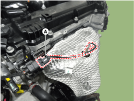
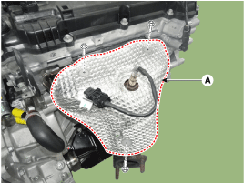
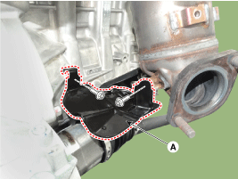
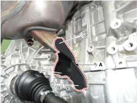
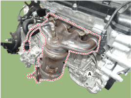

# Kia Sportage SL: Motorização NU / Exhaust Manifold Repair procedures

[Home](../../index.md) / [Kia Sportage SL Service & Repair Manual](../sportage-482.md) / [Motorização NU](index.md) / Exhaust Manifold Repair procedures

## Remoção e Instalação

1. Remova a capa do motor.

   (Consulte o Montagem do Motor e Transmissão - "Capa do Motor")

2. Desconecte o terminal negativo da bateria.

3. Desconecte as conexões do sensor de oxigênio (A).

   

4. Remova a capa inferior do motor.

   (Consulte o Montagem do Motor e Transmissão - "Capa Inferior do Motor")

5. Remova o silencioso da frente.

   (Consulte o Sistema de Admissão e Exaustão - "Silencioso")

6. Remova o protetor térmico do manifolds de exaustão (A).

   ```
   Torque de aperto:
   9,8 ~ 11,8 N.m (1,0 ~ 1,2 kgf.m, 7,2 ~ 8,7 lb-ft)
   ```

   

7. Remova o protetor térmico do eixo de transmissão (A).

   ```
   Torque de aperto:
   19,6 ~ 29,4 N.m (2,0 ~ 3,0 kgf.m, 14,5 ~ 21,7 lb-ft)
   ```

   

8. Remova a manivela de retenção do manifolds de exaustão (A).

   ```
   Torque de aperto:
   39,2 ~ 49,0 N.m (4,0 ~ 5,0 kgf.m, 28,9 ~ 36,2 lb-ft)
   ```

   

9. Remova o manifolds de exaustão (A) com a borracha de vedação.

   ```
   Torque de aperto:
   34,3 ~ 39,2 N.m (3,5 ~ 4,0 kgf.m, 25,3 ~ 28,9 lb-ft)
   ```

   

   > **Nota**
   >
   > - Ao instalar o manifolds de admissão, aperte as varetas com torque prévio primeiro, e depois aperte as varetas com torque especificado na sequência indicada.

10. Instale na ordem inversa da remoção.

   > **Nota**
   >
   > - Ao instalar, substitua a borracha de vedação por uma nova.
