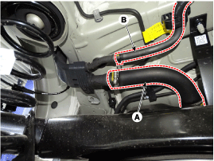
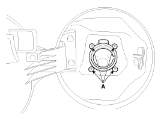
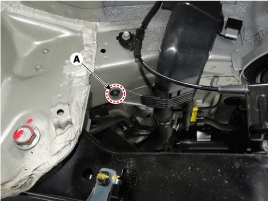

# Conjunto do bocal de abastecimento — procedimentos

[Home](../../index.md) / [Manual de Serviço e Reparo](../sportage-482.md) / [Motorização NU](index.md) / Conjunto do bocal de abastecimento — procedimentos

## Remoção

1. Remova a roda traseira-esquerda, pneu e a casa do porta-malas interno.

2. Desconecte o tubo do filtro de combustível (A) e o tubo de ventilação (B).

   

3. Abra o portão de enchimento de combustível e desafinque o parafuso de montagem do tanque de enchimento (A).

   

4. Remova o tanque de enchimento do veículo após remover os parafusos de montagem do gancho (A).

   

## Instalação

1. A instalação é o inverso da remoção.

   ```
   Parafuso de montagem do gancho do tanque de enchimento:
   7,8 ~ 11,8 N.m (0,8 ~ 1,2 kgf.m, 5,8 ~ 8,7 lb-ft)
   ```
