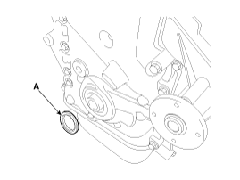

# Kia Sportage SL: Motorização NU / Front Oil Seal Repair procedures

[Home](../../index.md) / [Kia Sportage SL Service & Repair Manual](../sportage-482.md) / [Motorização NU](index.md) / Front Oil Seal Repair procedures

## Troca

1. Remova o amortecedor do pulley do buge.

   (Consulte o Sistema de Alineação - "Amortecedor do Pulley do Buje")

2. Remova a selante do freio (A).

   

3. Aplicar óleo do motor na borda da nova selante do freio.

   > **Nota**
   >
   > - Remova qualquer sujeira da parte lip da selante do freio.

4. Usando o SST (09231-2E000), instale uma nova selante do freio (A).

   

   > **Nota**
   >
   > - Não reutilize a selante do freio do lado frontal.

5. Instale o amortecedor do pulley do buje.

   (Consulte o Sistema de Alineação - "Amortecedor do Pulley do Buje")
