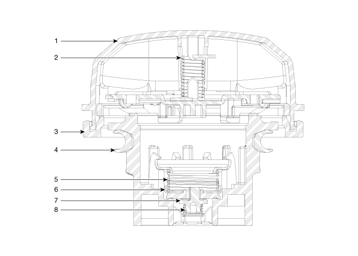

# Kia Sportage SL: Motorização NU / Fuel Filler Cap Description and Operation

[Home](../../index.md) / [Kia Sportage SL Service & Repair Manual](../sportage-482.md) / [Motorização NU](index.md) / Fuel Filler Cap Description and Operation

## Descrição

Um dispositivo de aperto com engrenagem no bocal de abastecimento de combustível com rosca reduz as chances de instalação incorreta, que selam o bocal de abastecimento. Após o selo do bocal de abastecimento e o flange do bocal de encher entrarem em contato, a engrenagem produz um som de clique alto indicando que o selo foi estabelecido.

| 1. Capa 2. Mola de torsão 3. Mancau 4. Selo do selo | 5. Mola 6. Selo do disco 7. Válvula de vácuo 8. Mola |
| --- | --- |
